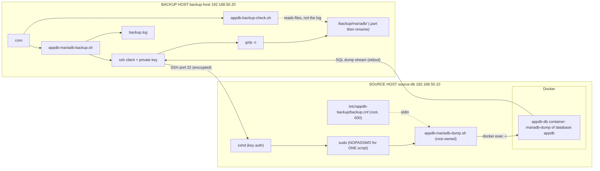
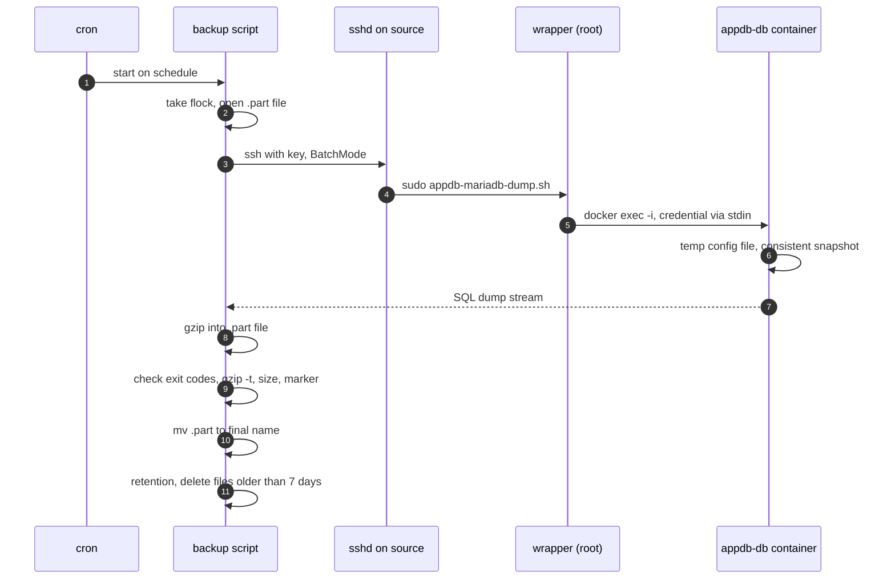
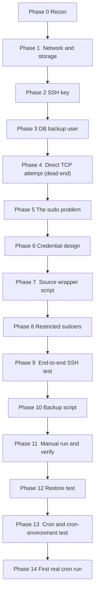
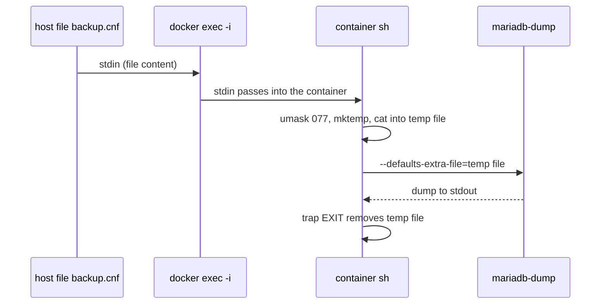
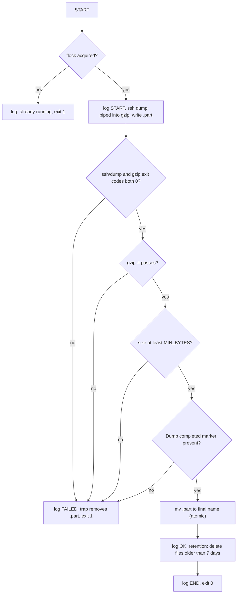
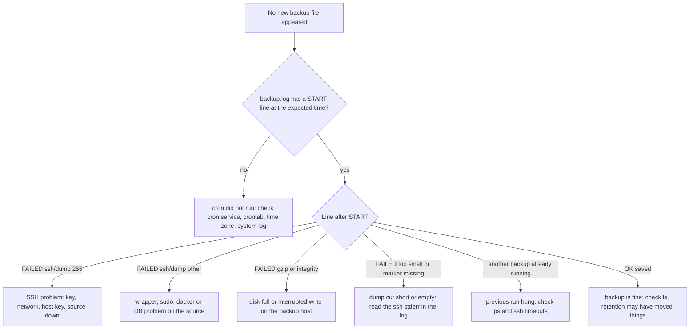
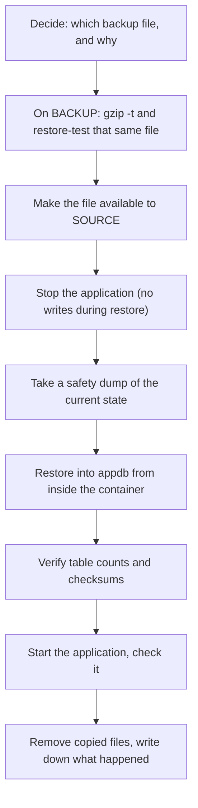

# MariaDB in Docker — Automated Remote Backup over SSH (Pull Model)

## Environment: two Linux hosts | MariaDB 11.8 in a Docker container | OpenSSH | cron | gzip

> **Lab material, not a production runbook.** Every hostname, IP address, user name and password in this guide is a lab value or a `<PLACEHOLDER>`. The database holds **generated test data** only. Test every procedure in a non-production environment first.

A step-by-step workbook for backing up a MariaDB database that runs **inside a Docker container with no published port**, to a **separate backup server**, using nothing but SSH, `sudo`, `gzip` and `cron`. It covers the design, the mechanisms underneath each command, the decisions that were rejected and why, every command with its real output, the failure drills, and the operational runbook.

## Tested

The whole procedure was executed end to end on **2026-11-19** in the two-host container lab included in this repository ([`remote-backup-lab/`](remote-backup-lab/)). Results, measured in that run:

| Check | Result |
|---|---|
| Database | MariaDB **11.8.9**, database `appdb`, 5 tables: 5,001 customers, 20,000 orders, 60,000 order items, 500 products, 2,000 audit events (generated) |
| Backup size | 507,870 bytes compressed (`.sql.gz`) |
| Restore into a throw-away container | 0.53 s, exit code 0 |
| Data integrity after restore | `CHECKSUM TABLE` identical on source and restored copy for **all 5 tables**; a Unicode row (`Zoë Müller 測試 ✓`) survived the round trip |
| Consistency under write load | A writer inserted rows into two tables (one transaction per pair) while the dump ran. Restored counts were **equal (11,482 = 11,482)** although the writer moved from 10,357 to 13,595 rows during the dump |
| Real `cron` runs | 3 consecutive scheduled runs succeeded, `cron.log` stayed empty |
| Failure drills | 6 failure modes (overlap, bad key, missing sudo rule, rotated DB password, stopped container, corrupt/zero-byte files) all detected and logged; where checked (bad key, missing sudo rule, rejected DB password) **no partial file** was left behind |
| Restore after damage | `TRUNCATE` of a table, then restore from backup: row count and checksum back to the pre-damage values |
| Hardening | SSH forced command applied; backup job still worked; asking the key for `id` returned the dump instead |

**What was not run:** the lab hosts are Alpine-based containers, so `systemctl`, `journalctl`, `apt` and `ssh-copy-id` steps are shown as they are used on Ubuntu/Debian VMs but were **not executed**. They are marked **VM only** where they appear. A full list of differences is in [Part 4](#part-4--lab-setup).

## Table of Contents

1. [Overview, requirements and architecture](#part-1--overview-requirements-and-architecture)
2. [Under the hood: the mechanisms](#part-2--under-the-hood)
3. [Design decisions](#part-3--design-decisions)
4. [Lab setup](#part-4--lab-setup)
5. [Hands-on workbook: Phase 0 to Phase 14](#part-5--hands-on-workbook)
6. [Failure drills and failure matrix](#part-6--failure-drills-and-failure-matrix)
7. [Security review and hardening](#part-7--security-review-and-hardening)
8. [Runbook, restore procedure and cheat sheet](#part-8--runbook-restore-procedure-and-cheat-sheet)
9. [Appendix: glossary and self-test](#appendix)

---

# Part 1 — Overview, requirements and architecture

## 1.1 The problem

A small web application runs on one server as three containers: the web app, a MariaDB container (`appdb-db`) and a reverse proxy. The database lives in a Docker named volume, so **all data sits on the same disk as the server**. If the disk fails, the server is lost, or someone runs `docker compose down -v`, the data is gone.

What is needed is a **regular copy on a different server**, plus **proof that the copy can actually be restored**.

Constraints that shape every decision below:

- The database port (3306) is **not published** and must not be opened.
- No change to the running containers or compose file (no recreate, no new mounts).
- No unrestricted root or Docker access for the backup account.
- The database password must never appear on a command line, in shell history, in `cron`, in a log or in `docker inspect`.

## 1.2 Requirements and the final solution

| # | Requirement | Solution |
|---|---|---|
| 1 | Copy lives on a different server | Backup host `192.168.50.20`, directory `/backup/mariadb/` |
| 2 | Fully automated | `cron` on the backup host |
| 3 | Key-based SSH, no passwords | `ed25519` key, dedicated to this job |
| 4 | Port 3306 stays closed | Dump runs **inside** the container via `docker exec`; only SSH crosses the network |
| 5 | Compressed, timestamped files | `appdb_YYYY-MM-DD_HHMMSS.sql.gz` |
| 6 | Retention | 7 days, applied only after a successful backup |
| 7 | Logging and error handling | `backup.log`, exit code of **every** stage checked |
| 8 | Integrity verification | Exit codes, `gzip -t`, minimum size, `Dump completed` marker |
| 9 | Proven restore | Restore into a throw-away MariaDB container, compare checksums |
| 10 | Secure credential handling | Root-only file on the source, passed over stdin, never an argument |
| 11 | No broad sudo | One root-owned wrapper script, one `sudoers` rule, zero arguments |
| 12 | Failure is noticed | Independent freshness check, not the backup script's own log |

## 1.3 Architecture



**How to read the picture**

- The **backup host starts everything** (pull model). The source host holds no key that can reach the backup host.
- Once inside via SSH, privilege narrows at every step: `sshd` → `sudo` (one script only) → wrapper → `docker exec`.
- The database password never leaves the right-hand box. The **data** travels left; the **credential** stays right.
- Port 3306 appears nowhere: it is not reachable from the network at all.

## 1.4 What happens during one backup run



## 1.5 Component inventory

**Source host (`source-db`, `192.168.50.10`)**

| Path | Owner:mode | Purpose |
|---|---|---|
| `/etc/appdb-backup/` | root:root `700` | Holds the credential. Only root can enter |
| `/etc/appdb-backup/backup.cnf` | root:root `600` | `backup_user` login. Goes into the container over **stdin** |
| `/usr/local/sbin/appdb-mariadb-dump.sh` | root:root `750` | Wrapper: dumps only `appdb` to stdout, takes no arguments |
| `/etc/sudoers.d/appdb-backup` | root:root `440` | Lets `backupadm` run that one wrapper without a password |
| `/home/backupadm/.ssh/authorized_keys` | backupadm `600` | Public key of the backup host (restricted, see Part 7) |
| MariaDB user `backup_user@localhost` | — | Read-only on `appdb.*` |

**Backup host (`backup-host`, `192.168.50.20`)**

| Path | Owner:mode | Purpose |
|---|---|---|
| `/usr/local/bin/appdb-mariadb-backup.sh` | root:root `755` | Main backup script (contains no secret) |
| `/usr/local/bin/appdb-backup-check.sh` | root:root `755` | Independent freshness and health check |
| `~backupadm/.ssh/mariadb_backup_key` (+ `.pub`) | backupadm `600` | Private key used to reach the source |
| `/backup/mariadb/` | backupadm `750` | Backup directory |
| `appdb_YYYY-MM-DD_HHMMSS.sql.gz` | backupadm `600` | The backups |
| `backup.log` / `cron.log` / `check.log` | backupadm | Script log / cron stdout+stderr (normally empty) / check results |
| `.appdb-backup.lock` | backupadm `600` | `flock` lock file (0 bytes is normal) |

## 1.6 Three design principles

1. **Pull, not push.** The backup host fetches the data. If the source is compromised, the attacker cannot reach or delete the backups (the ransomware scenario).
2. **Least privilege at every layer.** A read-only DB user for one database; `sudo` for one script; a script that takes no arguments; later, an SSH key bound to that one command.
3. **Verify, never trust.** "A backup file exists" does not mean "a backup will restore". Four layers of verification plus a separate restore test.

## 1.7 Phase map



---

# Part 2 — Under the hood

No commands are run in this part. It explains how each building block works so that the commands later make sense. Knowing the mechanism, not just the command, is what separates a senior DBA from someone following a recipe.

## 2.1 Logical vs physical backup

| | Logical (`mariadb-dump`) | Physical (`mariabackup`, volume copy) |
|---|---|---|
| What is stored | SQL statements (`CREATE TABLE`, `INSERT`) | Exact copy of the data files |
| Size | Small, compresses well | Close to the database size |
| Restore | Replays SQL (slow for large databases) | Put the files back (fast) |
| Version portability | Excellent: old → new works | Same or very close version needed |
| Human-readable | Yes | No |
| Point-in-time recovery | No (needs binary logs on top) | Possible with binary logs |

**Chosen here: logical.** The database is small, so slow restore is not a problem, and the benefits apply: it can be taken safely from inside a container, it survives version changes, and it can be inspected with `zcat | grep`.

**When to switch:** once the database reaches several GB, or when losing up to a full schedule interval is unacceptable, look at `mariabackup` plus binary logs.

## 2.2 How `mariadb-dump` gets a consistent snapshot without locking

A dump takes time. If the application changes data meanwhile, the first tables and the last tables would reflect different moments, which is **inconsistent**.

The old fix is `LOCK TABLES` on everything, which blocks writers for the whole dump. **`--single-transaction`** uses InnoDB **MVCC** (Multi-Version Concurrency Control) instead:

1. `mariadb-dump` sets `REPEATABLE READ` isolation.
2. It runs `START TRANSACTION WITH CONSISTENT SNAPSHOT`.
3. InnoDB creates a **read view**: "anything committed after this moment is invisible to this transaction".
4. Every table is then read through that view; the undo log supplies old row versions where other sessions have changed them.
5. Readers do not block writers and writers do not block the dump.


**Proven in the lab** (Phase 11.2): a writer inserted one row into `ledger_a` and one into `ledger_b` per transaction during the dump. The writer went from 10,357 to 13,595 rows while the dump ran; the restored copy had **11,482 rows in each table**. A dump without a consistent snapshot could show different counts.

**Limits to know:**

- Reliable for **InnoDB** only. MyISAM tables are not covered by the snapshot.
- DDL during the dump (`ALTER`/`DROP`/`RENAME`/`TRUNCATE TABLE`) is not isolated by the snapshot and can make a table's dumped contents wrong or make the dump fail, so avoid schema changes during the backup window.
- Very long dumps on very busy systems grow the undo history.

## 2.3 Why each dump option is there

| Option | Effect | Why it is here |
|---|---|---|
| `--single-transaction` | MVCC snapshot (2.2) | Consistent dump without stopping the app |
| `--quick` | Streams row by row, does not buffer a whole table | Memory stays flat as data grows |
| `--events` | Dumps scheduled events | `backup_user` has `EVENT` |
| `--triggers` | Dumps triggers (default, stated explicitly) | `backup_user` has `TRIGGER` |
| `--hex-blob` | Writes binary columns as hex | Binary data survives restore |
| `--default-character-set=utf8mb4` | Fixes the connection charset | Matches the server; non-Latin text is safe |
| (default) `--add-drop-table` | `DROP TABLE IF EXISTS` before each `CREATE TABLE` | Restore can be repeated, but it **deletes existing tables**. Be careful in production |
| (default) `--extended-insert` | Many rows per `INSERT` | Smaller file, faster restore |
| **Not used:** `--routines` | Would dump stored procedures/functions | `backup_user` has no routine-read privilege. **Routines are therefore not backed up**; the lab confirmed this: the dump contained 0 `CREATE PROCEDURE` statements even though a procedure existed. If the application uses routines, grant the privilege and add the option |

**The last line of a dump:** `/*M!100616 SET NOTE_VERBOSITY=@OLD_NOTE_VERBOSITY */;` means "only MariaDB runs this"; MySQL treats it as a comment. `/*!40101 ... */` means "run if the server version is at least 4.1.1". That is how one dump stays compatible with several servers.

## 2.4 Unix pipes, exit codes and `PIPESTATUS`

The core command is a pipeline:

```bash
ssh ... "sudo wrapper" | gzip -c > file.part
```

Data path: `ssh` stdout → pipe → `gzip` stdin → file.

**The trap:** `$?` holds only the exit code of the **last** command in the pipeline, here `gzip`. If `ssh` fails because the source is down, `gzip` still reads empty input and exits 0, producing an empty but valid `.gz`. `$?` is `0` and the backup is fake.

**The fix:** Bash's `PIPESTATUS` array holds the exit code of **every** command in the pipeline:

```bash
ssh ... | gzip -c > "$TMP"
rc=("${PIPESTATUS[@]}")      # must be the very next line
# rc[0] = ssh/dump, rc[1] = gzip
```

> **Rule:** any later command overwrites `PIPESTATUS`. Copy it into an array immediately after the pipeline.

**What `ssh` returns:** the exit code of the remote command. **255** means `ssh` itself failed (connection, authentication). Any other value is the remote command (here the wrapper or the dump) failing. The drills in Part 6 show both: code 255 for a bad key, code 1 for a missing sudo rule, code 2 for a rejected DB password.

**Why no `set -e` in the main script:** it behaves unpredictably in pipelines, and each failure should write its **own specific log message** before exiting. So the script uses `set -uo pipefail` (unset variable is an error; any pipeline stage failing counts) and handles each error explicitly with `|| fail "..."`.

## 2.5 How SSH carries the dump

**Remote command over SSH:** `ssh host "command"` opens an encrypted channel, runs `command` remotely, and the remote **stdout arrives on the local stdout**. That is why the remote dump behaves as part of the local pipeline.

**Why never `-t`:** `-t` allocates a pseudo-terminal. A TTY merges stderr into stdout, converts `\n` to `\r\n` and interprets control characters, which **corrupts binary or large text streams**. `-t` is only acceptable for interactive checks such as typing a sudo password.

**Key authentication:**

1. The backup host holds a key pair: **private key** (secret, mode `600`) and **public key**.
2. The public key goes into the source's `~/.ssh/authorized_keys`.
3. At login the source sends a random challenge; the backup host signs it with the private key; the source verifies with the public key. **The private key never crosses the network.**
4. `ed25519` is a modern elliptic-curve algorithm: short keys, fast, strong.

**`known_hosts` and the first `yes`:** the first connection shows the source's **host-key fingerprint**. Accepting stores it in `~/.ssh/known_hosts`. If someone later impersonates the source (man-in-the-middle), the fingerprint will not match and SSH warns loudly. This is **TOFU** (Trust On First Use).

**SSH options in the script**

| Option | Why |
|---|---|
| `-i <key>` | Use this exact key (there is no `ssh-agent` under cron) |
| `-o BatchMode=yes` | Never wait for a password or prompt; fail immediately. Nobody answers under cron |
| `-o ConnectTimeout=15` | Give up after 15 s if the source is unreachable |
| `-o ServerAliveInterval=30` `-o ServerAliveCountMax=4` | Probe every 30 s; after 4 missed answers (about 2 min) the connection is declared dead. Without it, a link that drops mid-dump leaves the script hanging forever |

## 2.6 `sudo` and `sudoers`

**Why `sudo` fails over non-interactive SSH:** there is no terminal, so `sudo` cannot ask for a password. Two messages appear:

- `sudo: a terminal is required to read the password` (a password is needed and there is no terminal to ask)
- `sudo: a password is required` (shown when `-n`, "never ask", is used)

**The idea:** a `NOPASSWD` rule for **exactly one command**.

```
backupadm ALL=(root) NOPASSWD: /usr/local/sbin/appdb-mariadb-dump.sh ""
 │         │    │       │                   │                          └─ exactly "no arguments"
 │         │    │       │                   └─ this exact path (full path is mandatory)
 │         │    │       └─ no password
 │         │    └─ runs as root
 │         └─ from any host
 └─ which user
```

**The trailing `""`:** in `sudoers`, a command with nothing after it allows any arguments. `""` means exactly zero arguments. Any attempt to pass an argument makes `sudo` ask for a password again (shown in the Phase 9 negative tests).

**Why the script must be root-owned and not writable:** a `NOPASSWD` rule means "whatever this file does is done as root". If `backupadm` could edit the script, or the directory it lives in, it could insert `bash` and obtain a root shell. **A weak `NOPASSWD` rule is a privilege-escalation backdoor.**

**Why `visudo -cf` first:** a syntax error in `sudoers` can disable `sudo` entirely, leaving no way to fix it without recovery mode. So the rule is written to a temp file, validated with `visudo -cf`, and only then installed into `/etc/sudoers.d/` with `install -m 440`. Files in `sudoers.d/` are independent: deleting one removes the permission and leaves the main `/etc/sudoers` untouched.

## 2.7 A container has its own filesystem: getting the password in

A container has its own filesystem, process list and network (Linux **namespaces**). A host path such as `/etc/appdb-backup/backup.cnf` does not exist inside the container unless it was mounted with `-v`.

**The problem:** the credential file is on the host, but `mariadb-dump` runs inside the container. How does the password get in?

**The stdin technique:**



- `docker exec -i` forwards stdin into the container.
- The container's `sh` writes it to a temp file (`mktemp`) created under `umask 077`, readable only by its owner.
- `mariadb-dump` reads it via `--defaults-extra-file`.
- `trap "rm -f $f" EXIT` removes the file however the shell ends (success, error or signal).

**Why it is safe:** the password is in no command-line argument (`ps` cannot show it), in no environment variable (`docker inspect` cannot show it), not in shell history, not written to the image or a volume, and no container or compose file had to change.

## 2.8 File permissions and `umask`

| Mode | Meaning | Used for |
|---|---|---|
| `700` | owner only: read, write, enter | `/etc/appdb-backup/` |
| `600` | owner only: read, write | credential, backups, private key |
| `750` | owner all; group read/enter; others none | `/backup/mariadb/`, wrapper |
| `755` | everyone can read and run | backup script (contains no secret) |
| `440` | owner and group read only | sudoers file |

**`umask`** is the mask of permissions to **remove** from newly created files. `umask 077` strips everything from group and others, so new files are `600` and new directories `700`.

**Why `umask` before, not `chmod` after:** `echo secret > file; chmod 600 file` leaves a window where the file is `644` and another user could read it (a **race condition**). With `umask 077` set first, the file is `600` from the moment it exists.

## 2.9 Atomic write: `.part`, then `mv`

**The problem:** if the server dies, the disk fills or the network drops mid-write, a half-written `appdb_...sql.gz` stays behind, looking exactly like a backup. Someone may restore from it.

**The fix:**

1. Write to `.appdb_<time>.sql.gz.part`. The leading `.` hides it from `ls`, and the name does not match the `appdb_*.sql.gz` pattern used by restore commands, retention and checks.
2. Run all verifications on the `.part` file.
3. Only then `mv .part final`. On the same filesystem `mv` is **atomic**: the kernel's `rename(2)` swaps the name in one step. Nobody ever sees a half-renamed file.

So **any file called `appdb_*.sql.gz` was complete and verified when it got its final name.** (The script does not call `fsync`, so after a power cut the newest file is worth re-checking; the checker's `gzip -t` does that.)

**Limit:** `kill -9` or a power cut skips the `trap`, so a stray `.part` can remain. It is harmless (nothing matches it) but worth deleting by hand now and then.

## 2.10 `flock`: preventing overlapping runs

```bash
exec 9>"$LOCK"        # open the lock file as file descriptor 9
flock -n 9            # -n = non-blocking: fail immediately if someone else holds it
```

- `flock` is a **kernel-managed advisory lock**. A second process asking for the same lock fails.
- **No stale locks:** when the process dies, the kernel releases the lock. A PID file, by contrast, can outlive its process and block every later run.
- The lock file stays 0 bytes: what matters is the lock held on the file, not its contents.
- "Advisory" means every participant must call `flock` voluntarily. That is enough here because every run is the same script.

## 2.11 Verification layers: what each check catches

| Check | Catches | Does **not** catch |
|---|---|---|
| Exit codes of `ssh` and `gzip` | Connection failure, wrapper/dump error, gzip error | A stream that was silently cut but ended without an error |
| `gzip -t` | Corruption and truncation (checks the CRC32 and length trailer) | Whether the **content** is right |
| Size ≥ 10 KB | Empty or near-empty dumps | Small but wrong dumps |
| Last lines contain `-- Dump completed` | The dump ran to the end (`mariadb-dump` writes this last) | Logical errors |
| **Restore test** (separate) | **Everything**: does the file actually restore | — |

**How `gzip -t` works:** a gzip file is a header, a **deflate** stream, then a **CRC32** checksum and the original size (**ISIZE**). `gzip -t` decompresses everything and compares both. A cut file reports `unexpected end of file` (seen in the Part 6 drill).

**Defence in depth:** each check catches a different failure; none is enough alone, together they cover nearly everything. And no backup is "good" until it has been restored: *a backup that has never been restored is a hope, not a backup.*

## 2.12 How cron works

```
0 6  * * *   command
│ │  │ │ │
│ │  │ │ └─ day of week (* = every day)
│ │  │ └─── month
│ │  └───── day of month
│ └──────── hour (0–23)
└────────── minute
```

**The cron environment is not your terminal:**

| | Terminal | Cron |
|---|---|---|
| `PATH` | Long, includes `/usr/local/bin` | Short: `/usr/bin:/bin` |
| Shell | bash, loads `.bashrc` | `/bin/sh -c`, no rc files |
| TTY | yes | no |
| `SSH_AUTH_SOCK` (agent) | maybe | no |
| Output | screen | mailed (if an MTA exists) or lost |

So the script uses only tools inside cron's short `PATH`, gives the **full path** of the SSH key (no `~`, no agent), and the cron line appends all output with `>> cron.log 2>&1`. "It works in my terminal" proves nothing about cron, which is why Phase 13 simulates the cron environment with `env -i`.

## 2.13 Time and time zones

Both servers keep **UTC**. `cron` follows the server's local time, so a schedule meant for another time zone must be converted. Example: to run at 12:00 and 21:00 in UTC+6 (no daylight saving), write `0 6 * * *` and `0 15 * * *`.

**The trap:** writing `0 12` would run at 18:00 local time, and `0 21` at 03:00. Log timestamps are UTC as well, so reading logs means converting in your head. Changing the server's time zone is possible but would also shift every other log and job on that server, so it is usually better left alone.

> In the lab, the host's `date` printed 12:47 while the containers' logs said 06:47 for the same instant: the host is UTC+6 and the containers are UTC. The same confusion happens in real life.

---

# Part 3 — Design decisions

Each decision: **problem → options → choice → why → why not the others.** A senior engineer explains what was *not* done and why.

## D1. Transport: how does the dump reach the backup host?

| Option | How | Problem | Decision |
|---|---|---|---|
| **a. Publish port 3306** | `ports: 3306:3306`, dump with `mariadb-dump -h` from the backup host | Opens the database to the network; needs compose change and container recreate; firewall rule; password and data travel in plaintext without TLS; also forbidden by the requirements | Rejected |
| **b. SSH tunnel** (`ssh -L`) | Tunnel to the container, dump through `127.0.0.1:<port>` | MariaDB sees the connection come from the Docker bridge address, not `localhost`, so `backup_user@localhost` does not match and a second user/host is needed. The client on the backup host may also be a different version from the server | Rejected |
| **c. SSH + `docker exec ... mariadb-dump`** | Dump runs inside the container; stdout returns over SSH | A little more setup (wrapper + sudoers) | **Chosen** |

**Why (c):** no new port; the dump client and the server come from the **same image**, so no version mismatch; the connection is over the container's **Unix socket**, so `backup_user@localhost` matches; only SSH, already present, crosses the network.

> Side lesson: installing a package does not mean using it. A MariaDB client on the backup host would have been installed and never used in the final design.

## D2. Who initiates: pull or push

| | Pull (chosen) | Push |
|---|---|---|
| Cron runs on | Backup host | Source host |
| Credential lives on | Backup host (a key to reach the source) | Source host (a key to write to the backup host) |
| If the source is compromised | Attacker cannot reach the backup host; backups are safe | Attacker holds the push key and can delete or corrupt backups |
| If the backup host is compromised | The source-access key can be stolen (so Part 7 binds it to one command) | The source is not directly at risk |

**Decision: pull.** The real enemies of backups are ransomware and accidental deletion, so keep backups as far out of the source's reach as possible.

## D3. Which DB account: `root` or a dedicated `backup_user`

`root` is easiest, but if that credential leaks, everything can be read, changed and dropped. A dedicated account bounds the damage.

**Privileges (only on `appdb.*`):**

| Privilege | Why |
|---|---|
| `SELECT` | Read table data |
| `SHOW VIEW` | Dump view definitions |
| `TRIGGER` | Dump triggers (`--triggers`) |
| `EVENT` | Dump events (`--events`) |
| `LOCK TABLES` | Fallback if the dump ever runs without `--single-transaction`; harmless otherwise |

**Deliberately not granted:** `INSERT/UPDATE/DELETE/DROP/ALTER` (cannot change anything), `RELOAD`, `PROCESS`, `SUPER` (global power), anything on other databases. In the lab, `SHOW DATABASES` as `backup_user` returned only `appdb` and `information_schema`.

**Why `@'localhost'`:** a MariaDB account is `name@host`. `backup_user@localhost` can only log in **from the machine itself** (here, inside the container over the socket). A network login with this name is refused, a free second layer of defence.

## D4. Five ways to get the password into the container

| Method | Problem | Decision |
|---|---|---|
| `-p'password'` argument | Visible in `ps aux` and shell history | Rejected |
| `docker exec -e MYSQL_PWD=...` | Visible in the host process list and `docker inspect` | Rejected |
| Mount a credential file with a compose `volume` | Requires recreating the container (a production change) | Rejected |
| Host file + `--defaults-extra-file=/host/path` | **Does not work**: the container cannot see host paths (shown in Phase 6.4) | Rejected |
| **Host file → stdin → temp file inside the container** | Slightly more involved | **Chosen** |

## D5. Sudo: running Docker without a password

| Option | Danger | Decision |
|---|---|---|
| `backupadm ALL=(ALL) NOPASSWD: ALL` | Permanent root | Rejected |
| Put `backupadm` in the `docker` group | `docker run -v /:/host ...` gives full root access to the host filesystem. **The docker group is effectively root** | Rejected |
| `NOPASSWD: /usr/bin/docker` | Arguments are uncontrolled; `docker run -v /:/host ...` is root again | Rejected |
| **Root-owned wrapper, `NOPASSWD` for that script only, zero arguments** | Two extra files | **Chosen** |

## D6. Backup format and tool

| Option | Comment |
|---|---|
| `mariadb-dump` → `.sql.gz` (chosen) | Ideal for small databases: simple, portable, readable |
| `mariabackup` (physical) | For big databases, fast restore, PITR; unnecessary here |
| Copy the Docker volume directly | Copying a running database yields **crash-inconsistent** files; stopping the database is needed. Rejected |

## D7. Retention design

- **Use `-mmin`, not `-mtime`.** `find -mtime +7` means "older than 7 *full* days", rounded down: effectively 8 days or more. To keep exactly 7 days use `-mmin +$((7*1440))` (10,080 minutes).
- **Run retention only after a successful backup.** A failed run must never delete the last good backup.
- Result: with two runs a day there are always about 14 files.

## D8. Where to run the restore test

| Option | Problem | Decision |
|---|---|---|
| A test database inside the source container | Extra load on the live system, needs root credentials, touches production | Rejected |
| Install `mariadb-server` on the backup host | The distribution's version may differ from the container's, giving false passes or failures; installs a permanent service | Rejected |
| Docker on the backup host (root daemon) | Adds a root daemon and firewall rules to a server whose other duties are unknown | Acceptable where Docker is already standard (**used in the lab**) |
| **Rootless Podman on the backup host with the production image tag** | No daemon, no root, no firewall changes, exact version, everything disposable | **Preferred on real servers** |

Whichever is used: same image tag as production, no published port, delete afterwards.

---

# Part 4 — Lab setup

The procedure needs two Linux hosts that can reach each other over SSH. Any two VMs work. This repository also ships a **two-container lab** that reproduces the same topology on one machine, and it is what produced every output shown in this guide.

## 4.1 Topology

| Host | Name | IP | Runs |
|---|---|---|---|
| Source | `source-db` | `192.168.50.10` | `sshd`, `sudo`, its own Docker daemon, the `appdb-db` MariaDB container |
| Backup | `backup-host` | `192.168.50.20` | SSH client, `cron`, `gzip`, its own Docker daemon (restore tests only) |

Both hosts have a non-root user **`backupadm`**. Each "host" is a privileged container with a nested Docker daemon (Docker-in-Docker), so the source can run MariaDB in a container exactly as a VM would.

> **Warning:** the lab containers are `privileged: true`. Use a disposable lab machine. Never run this on a shared or production Docker host.

## 4.2 Start the lab

```bash
cd mariadb/remote-backup-lab
docker compose up -d --build

# Load the MariaDB image into both nested daemons (avoids two pulls)
docker pull mariadb:11.8
docker save mariadb:11.8 | docker exec -i lab-source-db docker load
docker save mariadb:11.8 | docker exec -i lab-backup-host docker load
```

Convenience shells used by the rest of the guide:

```bash
docker exec -it lab-source-db bash                 # [SOURCE]  as root
docker exec -it lab-backup-host bash               # [BACKUP]  as root
docker exec -it -u backupadm lab-backup-host bash  # [BACKUP]  as backupadm
```

Tear down when finished (removes containers, nested images and all volumes):

```bash
docker compose down -v
```

## 4.3 How the lab differs from two Ubuntu/Debian VMs

| Area | On real VMs | In the container lab (what was actually run) |
|---|---|---|
| Package install (`apt install ...`) | needed | tools baked into the images — **VM-only steps not run** |
| `ssh-copy-id` with a password | installs the key | the lab user has no password; the public key is appended to `authorized_keys` directly (same end state) |
| First SSH host-key prompt | answer `yes` | handled with `-o StrictHostKeyChecking=accept-new`; same TOFU behaviour |
| `systemctl is-active cron`, `journalctl -u cron` | systemd | no systemd; BusyBox `crond` started directly, its log is `/var/log/crond.log` — **VM-only commands not run** |
| `crontab -` | Vixie/cronie | BusyBox `crontab`, same syntax |
| Restore-test runtime | rootless Podman (preferred) | root Docker daemon in the backup container |
| Userland | Ubuntu 24.04 | Alpine + GNU `coreutils`, `findutils`, `util-linux` (so `find -mmin`, `stat -c`, `flock` behave as on Ubuntu) |
| Shell commands in the guide | typed with `sudo` | the lab shells are already root, so `sudo` is omitted in the captured output |

Everything else — SSH, `sudo`/`sudoers`, Docker, MariaDB, `gzip`, `flock`, the scripts — is identical.

## 4.4 Generated test data

`remote-backup-lab/scripts/seed-appdb.sql` builds five related InnoDB tables (customers, products, orders, order items, audit events) using MariaDB's built-in `seq_1_to_N` generator, plus one Unicode row. No real data is involved. Load it after the container is running (Phase 0).

---

# Part 5 — Hands-on workbook

Every phase: **goal → where to run → commands → explanation → real output → if it goes wrong**.

Prompts tell you where you are. Look at the prompt before pressing Enter: running a command on the wrong server can be dangerous.

- **[SOURCE]** = `source-db` (`192.168.50.10`) — the host running MariaDB in Docker
- **[BACKUP]** = `backup-host` (`192.168.50.20`) — where backups are stored and cron runs

## Phase 0 — Recon: do not build anything before you know what is there

**Goal:** learn the container, volume, network, published ports and version.

**[SOURCE]**

```bash
sudo docker ps
```

```
NAMES      IMAGE          PORTS      STATUS
appdb-db   mariadb:11.8   3306/tcp   Up 26 seconds
```

`PORTS` shows only `3306/tcp`, not `0.0.0.0:...->3306/tcp`. The port is **not published to the host**; only containers on the same Docker network can reach it.

Ask Docker for exactly what you need (a Go template with `-f`):

```bash
# image, network, restart policy
sudo docker inspect -f 'Image={{.Config.Image}}  Net={{.HostConfig.NetworkMode}}  Restart={{.HostConfig.RestartPolicy.Name}}' appdb-db
# mounts
sudo docker inspect -f '{{range .Mounts}}{{.Type}} {{.Name}} -> {{.Destination}}{{"\n"}}{{end}}' appdb-db
# published ports (an empty {} means none)
sudo docker inspect -f '{{json .HostConfig.PortBindings}}' appdb-db
# only harmless environment variables
sudo docker exec appdb-db printenv | grep -E '^MARIADB_(DATABASE|USER)='
```

```
Image=mariadb:11.8  Net=bridge  Restart=always
volume appdb_data -> /var/lib/mysql
{}
MARIADB_USER=appuser
MARIADB_DATABASE=appdb
```

| Fact | Value |
|---|---|
| Image | `mariadb:11.8` (server 11.8.9) |
| Volume | `appdb_data` → `/var/lib/mysql` |
| Published ports | none (`{}`) |
| Restart policy | `always` |
| Database / app user | `appdb` / `appuser` |

> ### Mistake to avoid: never paste a full `docker inspect`
> Its `Config.Env` section lists every environment variable, **including passwords in plain text**:
> ```bash
> sudo docker inspect -f '{{range .Config.Env}}{{println .}}{{end}}' appdb-db | grep PASSWORD
> ```
> ```
> MARIADB_PASSWORD=<application password, in plain text>
> MARIADB_ROOT_PASSWORD=<root password, in plain text>
> ```
> (The lab printed its throw-away passwords here; they are replaced by placeholders in this document.)
> Anyone who can run `docker` (root or the `docker` group) can read these. Pasting full output into a chat, ticket or log leaks them for good. The official `mariadb` image supports `MARIADB_ROOT_PASSWORD_FILE` and Docker secrets, which avoid putting the password in the environment.

**Load the generated test data** (lab only):

```bash
docker exec -i lab-source-db docker exec -i appdb-db \
  mariadb -uroot -p"$ROOT_PW" appdb < scripts/seed-appdb.sql
```

```
table_name      table_rows
audit_events    2000
customers       5001
orders          19742      <- InnoDB estimate; the real count is 20,000 (see Phase 12)
order_items     60280      <- estimate; real count 60,000
products        500
```

## Phase 1 — Network and storage

**Goal:** a directory on the backup host, the tools it needs, and confirmed connectivity to the source.

**[BACKUP]**

```bash
# VM only (the lab images already contain these tools):
sudo apt update
sudo apt install -y openssh-client gzip

sudo mkdir -p /backup/mariadb
sudo chown backupadm:backupadm /backup/mariadb
sudo chmod 750 /backup/mariadb
df -h /backup

ping -c 2 192.168.50.10
```

```
--- 192.168.50.10 ping statistics ---
2 packets transmitted, 2 packets received, 0% packet loss
round-trip min/avg/max = 0.117/0.158/0.200 ms
```

**Explanation**

- `mkdir -p` creates missing parent directories and does not fail if the directory exists (idempotent).
- `chown backupadm:backupadm` lets the cron job (running as `backupadm`) write without `sudo`.
- `chmod 750`: only `backupadm` writes, the group may read, others get nothing.
- **Check `df -h /backup`.** If `/backup` is not its own mount, it is part of the root filesystem, and a runaway backup can fill the whole server. Small backups make this a low risk today; for growing databases use a separate volume or a disk-usage alert (Part 7).
- A `ttl` lower than the starting value (64 on Linux) shows the number of router hops in between.

**If it goes wrong:** `ping` works but `ssh` times out → run `ssh -v` and look for a firewall, a stopped `sshd` or a wrong port.

## Phase 2 — SSH key authentication

**Goal:** log in from the backup host to the source without a password.

**[BACKUP]** as `backupadm`

```bash
ssh-keygen -t ed25519 -f ~/.ssh/mariadb_backup_key -C "backupadm@backup-host mariadb-backup"
# Passphrase: press Enter twice (empty)

# VM: installs the public key, asking once for the source password
ssh-copy-id -i ~/.ssh/mariadb_backup_key.pub backupadm@192.168.50.10

ssh -i ~/.ssh/mariadb_backup_key backupadm@192.168.50.10 hostname
```

```
Warning: Permanently added '192.168.50.10' (ED25519) to the list of known hosts.
source-db
```

The key files, with correct permissions:

```
-rw------- 1 backupadm backupadm 432 ... mariadb_backup_key
-rw-r--r-- 1 backupadm backupadm 118 ... mariadb_backup_key.pub
```

**Explanation**

- **Empty passphrase:** nobody types a passphrase under cron. The cost is that anyone who steals the private key file can log in as `backupadm` on the source. **Mitigations:** the key is used only for this job, mode `600`, can be revoked by deleting one line from `authorized_keys`, and Part 7 restricts it to a single command.
- `ssh-copy-id` appends the public key to the source's `authorized_keys` and fixes permissions (`700` for `~/.ssh`, `600` for the file). In the lab the same result was achieved by appending the key directly.
- `"hostname"` at the end runs one remote command and exits; no interactive shell.
- The `Warning: Permanently added ...` line is the **TOFU** moment (Part 2.5).

## Phase 3 — Create a limited database user

**Goal:** a user that can read `appdb` and nothing else.

**[SOURCE]**

```bash
sudo docker exec -it appdb-db mariadb -uroot -p
# type the root password at the prompt (not on the command line)
```

```sql
CREATE USER 'backup_user'@'localhost'
  IDENTIFIED BY '<STRONG_PASSWORD>';

GRANT SELECT, SHOW VIEW, TRIGGER, EVENT, LOCK TABLES
  ON appdb.* TO 'backup_user'@'localhost';

SHOW GRANTS FOR 'backup_user'@'localhost';
```

```
Grants for backup_user@localhost
GRANT USAGE ON *.* TO `backup_user`@`localhost` IDENTIFIED BY PASSWORD '<hash>'
GRANT SELECT, LOCK TABLES, SHOW VIEW, EVENT, TRIGGER ON `appdb`.* TO `backup_user`@`localhost`
```

**Explanation**

- `docker exec -it`: `-i` keeps stdin open, `-t` allocates a terminal; an interactive client needs both.
- `-p` without a value prompts for the password, so it never touches the command line.
- Generate a strong password: `openssl rand -base64 24`. Do not make one up.
- `FLUSH PRIVILEGES` is unnecessary after `CREATE USER`/`GRANT` (MariaDB reloads privileges itself); it is only needed after editing the `mysql.*` tables directly.
- The grants are on `appdb.*` only. No write privileges, no `RELOAD`, `PROCESS` or `SUPER`.

## Phase 4 — A dead end that proves the design: direct TCP

**Goal:** show that the "obvious" approach, connecting to port 3306 from the backup host, is closed.

**[BACKUP]**

```bash
timeout 5 bash -c '</dev/tcp/192.168.50.10/3306'; echo "rc=$?"
timeout 5 bash -c '</dev/tcp/192.168.50.10/22' && echo "port 22 open"
```

```
bash: connect: Connection refused
bash: line 1: /dev/tcp/192.168.50.10/3306: Connection refused
rc=1
port 22 open
```

**This is a result, not a failure.** The database port is invisible on the network; SSH (22) is the only way in.

How to read connection errors:

| Symptom | Meaning |
|---|---|
| `Connection refused` | The host answered and nothing listens on that port (the lab case) |
| Hangs, then a timeout (MariaDB client: `ERROR 2002 ... (115)`) | Packets are silently dropped, typically by a firewall |
| `Could not open required defaults file` | A permissions problem on a local credential file, unrelated to the network |

If you built a client credential file for this dead-end experiment, **delete it** (it contains the password and is now useless).

## Phase 5 — The sudo problem

**Goal:** run `docker exec` on the source over SSH.

**[BACKUP]**

```bash
ssh -i ~/.ssh/mariadb_backup_key backupadm@192.168.50.10 "sudo -n docker ps"
```

```
sudo: a password is required
```

Without `-n`, the message is longer: `sudo: a terminal is required to read the password; either use ssh's -t option or configure an askpass helper`.

**Explanation:** the key login succeeds, but a remote command has no terminal, so `sudo` cannot prompt. Docker needs root, root needs `sudo`, `sudo` wants a password, and **nobody types a password under cron.** This is the central difficulty of the whole project. The answer is design decision D5: a **root-owned wrapper with a tightly scoped `NOPASSWD` rule**, built in Phases 7 and 8.

`-t` would make it work interactively but is not a solution: a TTY corrupts the dump stream (Part 2.5) and cron has nobody to type.

## Phase 6 — Credential design: get the password into the container safely

**Goal:** store `backup_user`'s password so that `mariadb-dump` (inside the container) can use it, without it escaping anywhere.

### 6.1 The tempting approach, and why it fails

A common first idea: write the credential file on the host and point the container's client at it:

```bash
sudo docker exec appdb-db mariadb --defaults-extra-file=/etc/appdb-backup/backup.cnf -e "SELECT 1"
```

```
Could not open required defaults file: /etc/appdb-backup/backup.cnf
Fatal error in defaults handling. Program aborted
```

The container has its own filesystem (Part 2.7); the host path does not exist inside it. **Test the design before building on it.**

### 6.2 The working method

Host root-only file → **stdin** → temporary file inside the container → `mariadb-dump` → file removed.

### 6.3 Create the credential file

**[SOURCE]**

```bash
# 1) secret directory: only root may enter
sudo install -d -m 700 -o root -g root /etc/appdb-backup

# 2) create the file; the password is typed at a prompt, so it stays out of history
sudo bash -c 'umask 077; read -rsp "Password: " p; echo; p=${p//\\/\\\\}; p=${p//\"/\\\"}; printf "[client]\nuser=backup_user\npassword=\"%s\"\n" "$p" > /etc/appdb-backup/backup.cnf; unset p'

# 3) verify without displaying the password
sudo ls -ld /etc/appdb-backup
sudo ls -l /etc/appdb-backup/
sudo wc -l /etc/appdb-backup/backup.cnf
sudo grep -c '^password=' /etc/appdb-backup/backup.cnf
```

```
drwx------ 2 root root 4096 ... /etc/appdb-backup
-rw------- 1 root root 70 ... backup.cnf
3 /etc/appdb-backup/backup.cnf
1
```

| Part | Why |
|---|---|
| `install -d -m 700 -o root -g root` | Creates directory, mode and owner in one command |
| `sudo bash -c '...'` rather than `sudo cmd > file` | In `sudo cmd > file` the **redirect `>` is performed by your own shell**, not as root, and would fail. Running the whole thing inside `bash -c` keeps the redirect inside root |
| `umask 077` | The file is `600` from the instant it exists (no race window, Part 2.8) |
| `read -rsp "Password: " p` | `-s` no echo, `-r` backslashes literal, `-p` prompt. The password goes into a variable, not into any command's arguments |
| `p=${p//\\/\\\\}` and `p=${p//\"/\\\"}` | Escape backslashes and double quotes |
| `printf "...password=\"%s\"\n" "$p"` | Writes the password in double quotes; inside quotes, `#`, `\` and `"` are safe. `%s` receives the value as an argument, so a `%` in the password is harmless |
| `unset p` | Remove the secret from memory-of-the-shell |
| `grep -c '^password='` | Confirms the line exists without printing it |

The lab used a generated password from `openssl rand -base64 24`, which contains `/`, `+` and `=` characters, so the escaping was exercised.

### 6.4 Test: does the login really work inside the container?

**[SOURCE]**

```bash
sudo -v     # refresh sudo's timestamp so both sides of the pipe need no password prompt

sudo cat /etc/appdb-backup/backup.cnf | sudo docker exec -i appdb-db sh -c \
  'umask 077; f=$(mktemp); trap "rm -f $f" EXIT; cat > "$f"; mariadb --defaults-extra-file="$f" -e "SHOW DATABASES;"'

sudo docker exec appdb-db ls -la /tmp      # temp file gone?
```

```
Database
appdb
information_schema
--- /tmp afterwards:
total 8
drwxrwxrwt 1 root root 4096 ... .
drwxr-xr-x 1 root root 4096 ... ..
```

Only the two expected databases appear and `/tmp` is empty again: the temporary file was removed.

**The container-side script, line by line**

| Line | Purpose |
|---|---|
| `umask 077` | Next file readable only by its owner |
| `f=$(mktemp)` | Unique temp file in `/tmp` (`/tmp/tmp.XXXXXX`) |
| `trap "rm -f $f" EXIT` | Removes the file however the shell ends. The double quotes expand `$f` **now**, fixing the name into the trap |
| `cat > "$f"` | Copies stdin (the host's file) into the temp file; stops at EOF |
| `mariadb --defaults-extra-file="$f" ...` | Reads user and password from the temp file. **`--defaults-extra-file` must be the first option** (a MariaDB rule) |

**Security window:** during the dump (about a second here) the password sits in a `600` file in the container's `/tmp`. Anyone who is root in the container could already read everything via `docker inspect`, so no new exposure is added.

## Phase 7 — The wrapper script on the source

**Goal:** one fixed-purpose script that runs as root on the source, takes no arguments and writes only the `appdb` dump to stdout.

### 7.1 Check that the options exist in this MariaDB version

**[SOURCE]**

```bash
sudo docker exec appdb-db mariadb-dump --version
sudo docker exec appdb-db mariadb-dump --help | grep -E '(^|[[:space:],])--(single-transaction|quick|events|triggers|hex-blob|routines|add-drop-table|default-character-set)([[:space:]=]|$)'
```

```
mariadb-dump from 11.8.9-MariaDB, client 10.20 for debian-linux-gnu (x86_64)
  --add-drop-table    Add a DROP TABLE before each create.
  --default-character-set=name
  -E, --events        Dump events.
  --hex-blob          Dump binary strings (BINARY, VARBINARY, BLOB) in
  -q, --quick         Don't buffer query, dump directly to stdout.
  -R, --routines      Dump stored routines (functions and procedures).
  --single-transaction
  --triggers          Dump triggers for each dumped table.
```

> **A lesson in false negatives.** An obvious first pattern is `^\s+--(quick|events|routines)`, anchored to lines that start with `--`. In `--help`, options with a short form are printed as `-q, --quick`, `-E, --events`, `-R, --routines`, so that pattern misses them (in the lab it matched only a stray continuation line). The result looks like "the option does not exist". **When a check says "no", first verify that the check itself is correct.**

### 7.2 Create the script

**[SOURCE]**

```bash
sudo tee /usr/local/sbin/appdb-mariadb-dump.sh > /dev/null <<'EOF'
#!/bin/bash
# Run on the SOURCE host as root (via restricted sudo).
# Streams a consistent dump of database "appdb" to stdout. Takes no arguments.
set -euo pipefail

CNF="/etc/appdb-backup/backup.cnf"
CONTAINER="appdb-db"

if [ ! -r "$CNF" ]; then
    echo "ERROR: credential file $CNF not readable" >&2
    exit 1
fi

exec /usr/bin/docker exec -i "$CONTAINER" sh -c '
umask 077
f=$(mktemp) || exit 1
trap "rm -f $f" EXIT
cat > "$f"
mariadb-dump --defaults-extra-file="$f" \
  --single-transaction --quick --events --triggers \
  --hex-blob --default-character-set=utf8mb4 appdb
' < "$CNF"
EOF

sudo chown root:root /usr/local/sbin/appdb-mariadb-dump.sh
sudo chmod 750 /usr/local/sbin/appdb-mariadb-dump.sh
sudo bash -n /usr/local/sbin/appdb-mariadb-dump.sh && echo "syntax OK"
sudo ls -l /usr/local/sbin/appdb-mariadb-dump.sh
```

```
syntax OK
-rwxr-x--- 1 root root 776 ... /usr/local/sbin/appdb-mariadb-dump.sh
```

(The same file is in [`remote-backup-lab/scripts/appdb-mariadb-dump.sh`](remote-backup-lab/scripts/appdb-mariadb-dump.sh).)

### 7.3 Line by line

| Line | Why |
|---|---|
| `<<'EOF'` (quoted) | Nothing inside the heredoc is expanded now; `$f`, `$(mktemp)` land in the file literally. Unquoted, your shell would evaluate them first |
| `sudo tee ... > /dev/null` | Solves the redirect-under-sudo problem: `tee` writes the file as root; `> /dev/null` hides the echo |
| `set -euo pipefail` | Stop on error, on unset variables, and on any pipeline failure. Control flow is simple here, so `-e` is safe |
| `[ ! -r "$CNF" ]` | Clear error on stderr and exit 1 if the credential file is missing |
| `exec /usr/bin/docker ...` | Replaces the shell with the docker process, so its exit code passes straight through. **Full path**, because `sudo` uses a fixed `secure_path` |
| `docker exec -i` (no `-t`) | stdin open, no TTY: a binary-safe stream |
| Outer single quotes | The whole inner script is passed literally to the **container's** `sh`; nothing expands on the host |
| `< "$CNF"` | The host credential file becomes `docker exec`'s stdin |
| trailing `appdb` | **Exactly one database.** There is no argument that can change it |

### 7.4 Test the wrapper (writes nothing to disk)

**[SOURCE]**

```bash
sudo /usr/local/sbin/appdb-mariadb-dump.sh | tail -n 3; echo "exit codes: ${PIPESTATUS[*]}"
sudo /usr/local/sbin/appdb-mariadb-dump.sh | grep -c '^CREATE TABLE'; echo "exit codes: ${PIPESTATUS[*]}"
```

```
/*M!100616 SET NOTE_VERBOSITY=@OLD_NOTE_VERBOSITY */;

-- Dump completed on 2026-11-19  6:44:40
exit codes: 0 0
5
exit codes: 0 0
```

`-- Dump completed` proves the dump ran to the end; 5 `CREATE TABLE` statements match the 5 tables.

## Phase 8 — The restricted `sudoers` rule

**Goal:** allow `backupadm` to run exactly that one wrapper without a password.

**[SOURCE]**

```bash
# 1) write to /tmp and validate first (a bad sudoers file can break sudo itself)
echo 'backupadm ALL=(root) NOPASSWD: /usr/local/sbin/appdb-mariadb-dump.sh ""' > /tmp/appdb-backup.sudoers
sudo visudo -cf /tmp/appdb-backup.sudoers

# 2) only if it says "parsed OK", install it
sudo install -m 440 -o root -g root /tmp/appdb-backup.sudoers /etc/sudoers.d/appdb-backup
rm -f /tmp/appdb-backup.sudoers

# 3) validate everything and show what backupadm may do
sudo visudo -c
sudo -l -U backupadm
```

```
/tmp/appdb-backup.sudoers: parsed OK
/etc/sudoers: parsed OK
/etc/sudoers.d/appdb-backup: parsed OK
...
User backupadm may run the following commands on source-db:
    (root) NOPASSWD: /usr/local/sbin/appdb-mariadb-dump.sh ""
```

**Why this order:** `visudo -cf` validates *before* installation. A broken file in place can disable `sudo` for the whole system, and fixing that needs recovery mode. `install -m 440` sets owner and mode atomically. The rule grammar is explained in Part 2.6: **one exact path, zero arguments, a root-owned script nobody else can write.**

## Phase 9 — End-to-end test along the exact path cron will use

**Goal:** from the backup host, log in with the key, run the wrapper without a password, and receive the dump stream. **This is the one test where hopping from one server to the other is really necessary,** because it validates the final path.

**[BACKUP]** as `backupadm`

```bash
# positive test: this must work
ssh -i ~/.ssh/mariadb_backup_key backupadm@192.168.50.10 "sudo /usr/local/sbin/appdb-mariadb-dump.sh" | tail -n 3; echo "exit codes: ${PIPESTATUS[*]}"

# negative tests: these must NOT work
ssh -i ~/.ssh/mariadb_backup_key backupadm@192.168.50.10 "sudo -n docker ps"
ssh -i ~/.ssh/mariadb_backup_key backupadm@192.168.50.10 "sudo -n /usr/local/sbin/appdb-mariadb-dump.sh --all-databases"
ssh -i ~/.ssh/mariadb_backup_key backupadm@192.168.50.10 "sudo -n cat /etc/appdb-backup/backup.cnf"
```

```
-- Dump completed on 2026-11-19  6:44:41
exit codes: 0 0
$ sudo -n docker ps
sudo: a password is required        (exit 1)
$ sudo -n /usr/local/sbin/appdb-mariadb-dump.sh --all-databases
sudo: a password is required        (exit 1)
$ sudo -n cat /etc/appdb-backup/backup.cnf
sudo: a password is required        (exit 1)
```

**Why negative tests matter:** proving that what should work works is not enough. Proving that **what should not work does not work** shows that no extra power was granted. `-n` means non-interactive: fail instead of prompting.

---

## Phase 10 — The main script on the backup host

**Goal:** one script that pulls the dump over SSH, compresses it, verifies it in four layers, stores it atomically, applies retention and logs everything.

**[BACKUP]**

```bash
sudo tee /usr/local/bin/appdb-mariadb-backup.sh > /dev/null <<'EOF'
#!/bin/bash
# Run on the BACKUP host (cron, as user backupadm).
# Pulls a dump of "appdb" from the source host over SSH, compresses, verifies,
# stores atomically, then applies retention. Never prints credentials.
set -uo pipefail
umask 077

# Defaults suit the lab; every value can be overridden from the environment (used by the drills).
BACKUP_DIR="${BACKUP_DIR:-/backup/mariadb}"
KEY="${KEY:-/home/backupadm/.ssh/mariadb_backup_key}"
REMOTE="${REMOTE:-backupadm@192.168.50.10}"
REMOTE_CMD="sudo /usr/local/sbin/appdb-mariadb-dump.sh"
RETENTION_DAYS="${RETENTION_DAYS:-7}"
MIN_BYTES="${MIN_BYTES:-10240}"

LOG="$BACKUP_DIR/backup.log"
LOCK="$BACKUP_DIR/.appdb-backup.lock"
TS="$(date +%F_%H%M%S)"
FINAL="$BACKUP_DIR/appdb_${TS}.sql.gz"
TMP="$BACKUP_DIR/.appdb_${TS}.sql.gz.part"

log() { echo "$(date '+%F %T') [$$] $*" >> "$LOG"; }

# Prevent overlapping runs
exec 9>"$LOCK"
if ! flock -n 9; then
    log "ERROR: another backup is already running, exiting"
    exit 1
fi

# Remove the incomplete file on any exit (after a successful mv it no longer exists)
trap 'rm -f "$TMP"' EXIT

fail() {
    log "FAILED: $*"
    exit 1
}

log "START backup -> $FINAL"

ssh -i "$KEY" \
    -o BatchMode=yes -o ConnectTimeout=15 \
    -o ServerAliveInterval=30 -o ServerAliveCountMax=4 \
    "$REMOTE" "$REMOTE_CMD" 2>>"$LOG" | gzip -c > "$TMP"
rc=("${PIPESTATUS[@]}")

[ "${rc[0]}" -eq 0 ] || fail "ssh/dump exited with code ${rc[0]}"
[ "${rc[1]}" -eq 0 ] || fail "gzip exited with code ${rc[1]}"

gzip -t "$TMP" 2>>"$LOG" || fail "gzip integrity check failed"

SIZE="$(stat -c %s "$TMP")"
[ "$SIZE" -ge "$MIN_BYTES" ] || fail "backup too small (${SIZE} bytes < ${MIN_BYTES})"

gzip -dc "$TMP" | tail -n 2 | grep -q '^-- Dump completed' \
    || fail "dump completion marker missing (truncated dump?)"

mv "$TMP" "$FINAL" || fail "could not move backup into place"
log "OK backup saved: $FINAL (${SIZE} bytes)"

# Retention: runs only after a successful backup, so the last good backup is never lost
find "$BACKUP_DIR" -maxdepth 1 -type f -name 'appdb_*.sql.gz' -mmin +"$((RETENTION_DAYS*1440))" \
    -print -delete 2>>"$LOG" | while read -r old; do log "RETENTION removed: $old"; done

log "END"
exit 0
EOF

sudo chown root:root /usr/local/bin/appdb-mariadb-backup.sh
sudo chmod 755 /usr/local/bin/appdb-mariadb-backup.sh
sudo bash -n /usr/local/bin/appdb-mariadb-backup.sh && echo "syntax OK"
```

(The same file is in [`remote-backup-lab/scripts/appdb-mariadb-backup.sh`](remote-backup-lab/scripts/appdb-mariadb-backup.sh).)

> After pasting a large heredoc into a terminal, verify the file: `wc -l` and a quick `sed -n` of the key lines. Pasting can scramble lines.

### 10.1 Decision flow



### 10.2 The important parts

| Part | Explanation |
|---|---|
| `set -uo pipefail` | `-u` unset variable is an error. `-e` is left out on purpose (Part 2.4) |
| `umask 077` | Backups are `600`: a database dump is sensitive |
| `TS="$(date +%F_%H%M%S)"` | `2026-11-19_064448`: second resolution, so two backups in one day never collide |
| `$$` in `log` | The script's PID; lets you separate two runs whose log lines interleave |
| `exec 9>"$LOCK"` + `flock -n 9` | Part 2.10: a second run fails instantly and logs why |
| `trap 'rm -f "$TMP"' EXIT` | Any exit path removes the `.part`. After a successful `mv` there is nothing left to remove |
| `fail()` | Logs one message and exits 1; `exit` triggers the `trap` |
| `2>>"$LOG"` on `ssh` | The remote's error text goes to the log and **cannot mix into the dump** on stdout |
| `rc=("${PIPESTATUS[@]}")` | Directly after the pipeline (Part 2.4) |
| `gzip -dc ... \| tail -n 2 \| grep -q` | The last two lines must contain `-- Dump completed` |
| `mv "$TMP" "$FINAL"` | Atomic rename (Part 2.9) |
| `find ... -mmin +10080 -print -delete` | Deletes backups older than exactly 7 days. **Action order matters:** `-print` before `-delete` so the log records what was removed. `-maxdepth 1` keeps it to this directory; the `-name` pattern never touches `.part` files |
| `MIN_BYTES=10240` | A heuristic. A schema-only dump compresses to under 10 KB, so the limit catches near-empty dumps. **Tune it for your database** |

**Known limits:** retention looks at the file's modification time, so a `touch` or a clock change moves the deletion time. Several failed runs in a row do not delete good backups, which then stay for up to 7 days.

## Phase 11 — Run by hand and verify

**Goal:** see the script work before scheduling it.

**[BACKUP]** as `backupadm`

```bash
/usr/local/bin/appdb-mariadb-backup.sh; echo "exit code: $?"
ls -lah /backup/mariadb/
tail -n 5 /backup/mariadb/backup.log
```

```
exit code: 0
-rw------- 1 backupadm backupadm    0 ... .appdb-backup.lock
-rw------- 1 backupadm backupadm 496K ... appdb_2026-11-19_064448.sql.gz
-rw------- 1 backupadm backupadm  224 ... backup.log
2026-11-19 06:44:48 [459] START backup -> /backup/mariadb/appdb_2026-11-19_064448.sql.gz
2026-11-19 06:44:48 [459] OK backup saved: /backup/mariadb/appdb_2026-11-19_064448.sql.gz (507870 bytes)
2026-11-19 06:44:48 [459] END
```

No `.part` file remains, and the lock file is 0 bytes (normal).

### 11.1 Inspect the contents

```bash
F=$(ls -1t /backup/mariadb/appdb_*.sql.gz | head -n 1); echo "$F"
gzip -t "$F" && echo "gzip integrity OK"
zcat "$F" | grep -c '^CREATE TABLE'
zcat "$F" | grep -c '^INSERT INTO'
zcat "$F" | tail -n 1
zcat "$F" | grep '^INSERT INTO' | cut -d'`' -f2 | sort | uniq -c
```

```
gzip integrity OK
5
5
-- Dump completed on 2026-11-19  6:44:48
      1 audit_events
      1 customers
      1 order_items
      1 orders
      1 products
```

| Observation | Meaning |
|---|---|
| `gzip integrity OK` | The compressed stream is intact |
| 5 `CREATE TABLE` | All five tables are present |
| 5 `INSERT INTO` | Every table has data |
| Every `uniq -c` count is `1` | **`--extended-insert` puts many rows into one `INSERT`.** `1` does not mean one row; it only says "this table has data" |

### 11.2 Prove consistency under write load

A real application keeps writing during the dump. This test shows the snapshot is consistent anyway.

**[SOURCE]** create two tables and a procedure that inserts one row into each, per transaction:

```sql
CREATE TABLE ledger_a (id INT AUTO_INCREMENT PRIMARY KEY, ts TIMESTAMP(6)) ENGINE=InnoDB;
CREATE TABLE ledger_b (id INT AUTO_INCREMENT PRIMARY KEY, ts TIMESTAMP(6)) ENGINE=InnoDB;
DELIMITER //
CREATE PROCEDURE churn(n INT)
BEGIN
  DECLARE i INT DEFAULT 0;
  WHILE i < n DO
    START TRANSACTION;
    INSERT INTO ledger_a(ts) VALUES (NOW(6));
    INSERT INTO ledger_b(ts) VALUES (NOW(6));
    COMMIT;
    SET i = i + 1;
  END WHILE;
END//
DELIMITER ;
```

Start the writer in the background (`CALL churn(40000)`), wait three seconds, run the backup, then restore that backup into a scratch database and compare:

```
writer rows at dump start:   10357
backup exit: 0               (OK backup saved ... 652850 bytes)
writer rows after dump:      13595
restored (must be equal):
ledger_a    ledger_b
11482       11482
procedures in dump:          0
```

Both tables hold **11,482** rows although the writer was at 10,357 when the dump started and at 13,595 when it ended: the dump captured one consistent instant. The last line confirms the earlier warning: `churn` is a stored procedure and is **not** in the dump, because `--routines` is not used (Part 2.3).

Clean up afterwards: `DROP PROCEDURE appdb.churn; DROP TABLE appdb.ledger_a, appdb.ledger_b;`

## Phase 12 — Restore test: does the backup really restore?

**Goal:** prove the data comes back, without touching the source.

### 12.1 Start a disposable MariaDB with the production image tag

**[BACKUP]** (Docker shown; rootless Podman is the same command with `podman`)

```bash
docker run -d --name appdb_restore_test \
  -e MARIADB_ALLOW_EMPTY_ROOT_PASSWORD=1 \
  -e MARIADB_DATABASE=restore_test \
  mariadb:11.8 \
  --character-set-server=utf8mb4 --collation-server=utf8mb4_unicode_ci

sleep 20; docker logs --tail 2 appdb_restore_test
docker exec appdb_restore_test mariadb -uroot -e "SELECT VERSION();"
```

```
... [Note] mariadbd: ready for connections.
Version: '11.8.9-MariaDB-ubu2404'  socket: '/run/mysqld/mysqld.sock'  port: 3306 ...
VERSION()
11.8.9-MariaDB-ubu2404
```

- **No `-p`:** no port is published; the container is reachable only through `docker exec`.
- **Empty root password:** acceptable only because this container is throw-away and unreachable from the network. **Never use it for anything persistent or exposed.**
- Charset and collation match production; mismatches can make a restore fail or differ.
- `MARIADB_DATABASE` creates an empty database to restore into.
- Same version as production proves the restore works on the version you actually run.

### 12.2 Restore and verify

```bash
F=$(ls -1t /backup/mariadb/appdb_*.sql.gz | head -n 1)
time (zcat "$F" | docker exec -i appdb_restore_test mariadb -uroot restore_test)

docker exec appdb_restore_test mariadb -uroot -e "
SELECT COUNT(*) AS tables_restored FROM information_schema.tables WHERE table_schema='restore_test';
SELECT (SELECT COUNT(*) FROM restore_test.customers) customers,
       (SELECT COUNT(*) FROM restore_test.orders) orders,
       (SELECT COUNT(*) FROM restore_test.order_items) order_items,
       (SELECT COUNT(*) FROM restore_test.products) products,
       (SELECT COUNT(*) FROM restore_test.audit_events) audit_events;
SELECT name FROM restore_test.customers WHERE id=5001;"
```

```
real    0m0.532s
tables_restored
5
customers  orders  order_items  products  audit_events
5001       20000   60000        500       2000
name
Zoë Müller 測試 ✓
```

### 12.3 Compare checksums with the source

Row counts can match while content differs. `CHECKSUM TABLE` compares content:

```bash
# restored copy
docker exec appdb_restore_test mariadb -uroot -N -e "CHECKSUM TABLE restore_test.customers, restore_test.orders, restore_test.order_items, restore_test.products, restore_test.audit_events;"
# source
docker exec appdb-db mariadb -uroot -p -N -e "CHECKSUM TABLE appdb.customers, appdb.orders, appdb.order_items, appdb.products, appdb.audit_events;"
```

| Table | Restored | Source |
|---|---|---|
| customers | 4152818165 | 4152818165 |
| orders | 2973833237 | 2973833237 |
| order_items | 2443581461 | 2443581461 |
| products | 3983887976 | 3983887976 |
| audit_events | 2538957257 | 2538957257 |

All five are identical. (Checksums are comparable like this when engine, version and row format are the same, as here.)

> **Estimate vs exact:** in Phase 0, `information_schema.tables.table_rows` showed `orders = 19742`, but `COUNT(*)` returns **20,000**. For InnoDB, `table_rows` is an estimate. Use `COUNT(*)` or `CHECKSUM TABLE` when you need proof.

### Why could the dump be restored into `restore_test`?

The dump was taken with a single database name (`... appdb`). In that case `mariadb-dump` writes **no `CREATE DATABASE` and no `USE`** lines (those appear only with `--databases` or `--all-databases`). The SQL therefore lands in whichever database you point the client at. That is why we restored into `restore_test`, and it is also why, in a **real restore, you must name the target database yourself**; a wrong name loads the data into the wrong place.

### 12.4 Clean up

```bash
docker rm -f appdb_restore_test
```

Keep the runtime (Docker or Podman) installed if you will run monthly restore tests. On a VM, if you remove it, **do not run `apt autoremove`** without reading the list; it may remove unrelated packages.

## Phase 13 — Put it in cron and test in the cron environment

### 13.1 Install the schedule

**[BACKUP]** as `backupadm`

```bash
crontab -l        # check what already exists

( crontab -l 2>/dev/null; cat <<'EOF'
# appdb MariaDB backup: 12:00 and 21:00 UTC+6 (server clock is UTC)
0 6  * * * /usr/local/bin/appdb-mariadb-backup.sh >> /backup/mariadb/cron.log 2>&1
0 15 * * * /usr/local/bin/appdb-mariadb-backup.sh >> /backup/mariadb/cron.log 2>&1
EOF
) | crontab -

crontab -l
systemctl is-active cron      # VM only: expect "active"
```

> **In the lab** the every-minute variant from Phase 14 was installed instead, as root with BusyBox `crontab -u backupadm -`; the commands above are the standard Ubuntu/Debian form of the same step.

**Explanation**

- `crontab -` **replaces the whole crontab** from stdin. That is why existing lines are printed first with `crontab -l 2>/dev/null` and the new lines are appended; otherwise old jobs vanish. `2>/dev/null` only hides the "no crontab" message.
- **Run this block once.** Twice gives duplicate lines and double backups (`flock` would block the second, but it is untidy).
- `>> cron.log 2>&1` sends both stdout and stderr to the file. **Order matters:** redirect to the file first, then `2>&1`.
- The script logs to `backup.log`. `cron.log` exists for the rare case where the script dies before it can open its own log (for example a permissions problem). **Normally `cron.log` is empty, and that is the correct state.**

### 13.2 Simulate the cron environment

```bash
env -i HOME=/home/backupadm LOGNAME=backupadm PATH=/usr/bin:/bin SHELL=/bin/sh \
  /bin/sh -c '/usr/local/bin/appdb-mariadb-backup.sh >> /backup/mariadb/cron.log 2>&1'; echo "exit code: $?"
ls -l /backup/mariadb/cron.log
tail -n 2 /backup/mariadb/backup.log
```

```
exit code: 0
-rw-r--r-- 1 backupadm backupadm 0 ... /backup/mariadb/cron.log
2026-11-19 06:47:25 [1560] OK backup saved: /backup/mariadb/appdb_2026-11-19_064725.sql.gz (1011743 bytes)
2026-11-19 06:47:25 [1560] END
```

`env -i` wipes the environment and sets only a minimum. **No `SSH_AUTH_SOCK`**, so a hidden dependence on an SSH agent would fail here. `cron.log` is 0 bytes: no unexpected errors.

Note that `cron.log` was created `-rw-r--r--` (the shell's default umask applies to the redirect). Others could read it, but `/backup/mariadb/` is `750`, so they cannot enter the directory, and the file is normally empty.

## Phase 14 — Watch a real cron run

To observe a real scheduled run, the lab used an every-minute schedule (production uses the twice-daily lines from 13.1):

```
# LAB schedule: every minute so the run can be observed. Production example: 0 6,15 * * *
* * * * * /usr/local/bin/appdb-mariadb-backup.sh >> /backup/mariadb/cron.log 2>&1
```

After two and a half minutes:

```bash
grep -E 'START|OK' /backup/mariadb/backup.log | tail -n 6
cat /backup/mariadb/cron.log
```

```
2026-11-19 06:48:00 [1601] START backup -> /backup/mariadb/appdb_2026-11-19_064800.sql.gz
2026-11-19 06:48:00 [1601] OK backup saved: ... (1011744 bytes)
2026-11-19 06:49:00 [1633] START backup -> /backup/mariadb/appdb_2026-11-19_064900.sql.gz
2026-11-19 06:49:00 [1633] OK backup saved: ... (1011744 bytes)
2026-11-19 06:50:00 [1665] START backup -> /backup/mariadb/appdb_2026-11-19_065000.sql.gz
2026-11-19 06:50:00 [1665] OK backup saved: ... (1011744 bytes)
(cron.log: empty)
```

Three scheduled runs, started by `crond` itself, all succeeded; `cron.log` stayed empty. After the observation the test schedule was removed.

**On a real server, still check:** the first run after each scheduled time, and after 7 days that retention really deleted the oldest file.

---

# Part 6 — Failure drills and failure matrix

A backup that works on a good day proves little. Each drill below **breaks something on purpose**, shows what the script does, and checks that no partial file is left behind. All outputs are from the lab run.

All commands: **[BACKUP]** as `backupadm`, unless stated. `show` below means:
`tail -n 3 backup.log; ls /backup/mariadb | grep -c '^appdb_.*sql.gz$'; ls -a /backup/mariadb | grep -c part`.

## D1. Overlapping runs (`flock`)

Hold the lock in one shell and start the script in another:

```bash
exec 8>/backup/mariadb/.appdb-backup.lock; flock -n 8
/usr/local/bin/appdb-mariadb-backup.sh; echo "second run exit: $?"
tail -n 1 /backup/mariadb/backup.log
```

```
second run exit: 1
2026-11-19 06:46:42 [1220] ERROR: another backup is already running, exiting
```

The second run exits at once and says why. No second dump, no extra load.

## D2. Wrong or missing SSH key

```bash
KEY=/home/backupadm/.ssh/does_not_exist /usr/local/bin/appdb-mariadb-backup.sh; echo "exit: $?"
```

```
exit: 1
Warning: Identity file /home/backupadm/.ssh/does_not_exist not accessible: No such file or directory.
backupadm@192.168.50.10: Permission denied (publickey,keyboard-interactive).
2026-11-19 06:46:42 [1230] FAILED: ssh/dump exited with code 255
backup files: 3     part files: 0
```

Exit code **255** = `ssh` itself failed (Part 2.4). The SSH error text went to the log through `2>>"$LOG"`, not into a dump. No `.part` file remains.

## D3. The sudo rule disappears

**[SOURCE]** `mv /etc/sudoers.d/appdb-backup /root/appdb-backup.sudoers.off`, then run the backup:

```
exit: 1
sudo: a terminal is required to read the password; either use ssh's -t option or configure an askpass helper
sudo: a password is required
2026-11-19 06:46:42 [1255] FAILED: ssh/dump exited with code 1
backup files: 3     part files: 0
```

Exit code **1** (not 255): SSH worked, the remote command failed. The rule was restored afterwards.

## D4. The database password changes and the credential file does not

**[SOURCE]** `ALTER USER 'backup_user'@'localhost' IDENTIFIED BY '<new password>'`, credential file left as it was:

```
exit: 1
mariadb-dump: Got error: 1045: "Access denied for user 'backup_user'@'localhost' (using password: YES)" when trying to connect
2026-11-19 06:46:43 [1280] FAILED: ssh/dump exited with code 2
backup files: 3     part files: 0
```

Exit code **2** is `mariadb-dump`'s own error, passed through `exec docker exec` and SSH. This is the most realistic silent failure: someone changes or hardens credentials and the backup job's copy no longer matches.

**Fix:** set a new random password, rewrite `/etc/appdb-backup/backup.cnf` with the Phase 6.3 command, run the Phase 6.4 test, run the backup:

```
exit: 0
2026-11-19 06:46:54 [1324] OK backup saved: /backup/mariadb/appdb_2026-11-19_064653.sql.gz (1011743 bytes)
```

## D5. Zero-byte and truncated backup files

Simulate a failed run that left a zero-byte file and a file cut in half:

```bash
cd /backup/mariadb
: > appdb_2099-01-01_000000.sql.gz
head -c 100000 "$(ls -1t appdb_2026*.sql.gz | head -n 1)" > appdb_2099-01-01_000001.sql.gz
gzip -t appdb_2099-01-01_000001.sql.gz; echo "gzip -t rc=$?"
/usr/local/bin/appdb-backup-check.sh; echo "check rc=$?"
```

```
-rw-r--r-- 1 backupadm backupadm      0 ... appdb_2099-01-01_000000.sql.gz
-rw-r--r-- 1 backupadm backupadm 100000 ... appdb_2099-01-01_000001.sql.gz
gzip: unexpected end of file
gzip -t rc=1
CRITICAL zero-byte backup file: /backup/mariadb/appdb_2099-01-01_000000.sql.gz
CRITICAL newest backup fails gzip -t: /backup/mariadb/appdb_2099-01-01_000001.sql.gz
check rc=2
```

`gzip -t` catches the truncated file; the freshness check (Part 7.3) reports both problems. The test files were removed afterwards.

## D6. The database container is stopped

**[SOURCE]** `docker stop appdb-db`, then run the backup:

```
exit: 1
Error response from daemon: container ee8b9760fed0... is not running
2026-11-19 06:46:54 [1391] FAILED: ssh/dump exited with code 1
```

After `docker start appdb-db` the next run returned to `OK`.

## D7. Retention

Create two copies with different ages and run a backup:

```bash
cp -p "$F" appdb_2026-11-11_000000.sql.gz && touch -d "8 days ago" appdb_2026-11-11_000000.sql.gz
cp -p "$F" appdb_2026-11-13_000000.sql.gz && touch -d "6 days ago" appdb_2026-11-13_000000.sql.gz

# dry run: shows what would go, deletes nothing
find /backup/mariadb -maxdepth 1 -type f -name 'appdb_*.sql.gz' -mmin +10080 -ls
```

```
  6452122    992 -rw------- 1 backupadm backupadm 1011743 Nov 11 06:47 /backup/mariadb/appdb_2026-11-11_000000.sql.gz
```

After the next backup:

```
2026-11-19 06:47:24 [1539] OK backup saved: ... (1011743 bytes)
2026-11-19 06:47:24 [1539] RETENTION removed: /backup/mariadb/appdb_2026-11-11_000000.sql.gz
```

The 8-day-old file was removed and logged; the 6-day-old file stayed.

## Summary of exit codes

| Code in the log | Meaning | Drill |
|---|---|---|
| `ssh/dump exited with code 255` | SSH itself failed: network, key, host key | D2 |
| `ssh/dump exited with code 1` | The remote command failed before the dump: `sudo`, missing credential file, container not running | D3, D6 |
| `ssh/dump exited with code 2` | `mariadb-dump` failed: login, privilege, connection | D4 |
| `gzip integrity check failed` | Local write problem: full disk, I/O error | — |
| `backup too small` / `completion marker missing` | Dump cut short or empty | — |
| `another backup is already running` | Overlapping run | D1 |

## 6.1 "Today's backup did not appear": where to look first



## 6.2 Failure matrix

| Symptom | Likely cause | How to confirm | Fix |
|---|---|---|---|
| `ssh/dump exited with code 255` | SSH failure: source down, no network, key or host-key problem | **[BACKUP]** `ssh -i ~/.ssh/mariadb_backup_key -v backupadm@192.168.50.10 hostname` | Read the verbose output, see rows below |
| `Permission denied (publickey)` | Key removed from `authorized_keys`; wrong permissions on source `~/.ssh` (`700`/`600`) or on the private key (`600`) | **[SOURCE]** `ls -ld ~/.ssh; ls -l ~/.ssh/authorized_keys` | Fix permissions; re-install the key |
| `REMOTE HOST IDENTIFICATION HAS CHANGED` | Source was rebuilt or reinstalled; or a real man-in-the-middle | Establish why it changed | If confirmed legitimate: `ssh-keygen -R 192.168.50.10` on **[BACKUP]**, reconnect. **Never do this without knowing why** |
| `sudo: a password is required` in the log | Sudoers rule missing/changed/wrong path; or someone passes an argument | **[SOURCE]** `sudo -l -U backupadm`, `sudo visudo -c` | Restore `/etc/sudoers.d/appdb-backup` (Phase 8) |
| `ERROR: credential file ... not readable` | `/etc/appdb-backup/backup.cnf` missing or moved | **[SOURCE]** `sudo ls -l /etc/appdb-backup/` | Re-create (Phase 6.3) |
| `No such container` / `is not running` | Container renamed, stopped or recreated | **[SOURCE]** `sudo docker ps -a` | Start it; if renamed, update `CONTAINER` in the wrapper |
| `Access denied for user 'backup_user'@'localhost'` | Password changed, typo in the `.cnf`, user dropped | **[SOURCE]** repeat the Phase 6.4 test | Rewrite the `.cnf` (Phase 6.3) |
| `SELECT command denied` / `SHOW CREATE ... denied` | New view/event added that `backup_user` cannot read | Read the SSH stderr in `backup.log` | Grant exactly what is missing |
| `backup too small` | Empty or shrunken database, or `MIN_BYTES` wrong | Preceding log lines | Find the cause; adjust `MIN_BYTES` to the data |
| `dump completion marker missing` | Dump cut mid-stream (network, OOM, container restart) | SSH stderr in the log | Re-run; if repeated, check the source `dmesg` and container logs |
| `gzip integrity check failed` | Disk filled or I/O error while writing | **[BACKUP]** `df -h /backup; dmesg \| tail` | Free space |
| `another backup is already running` | Previous run is hung | **[BACKUP]** `ps aux \| grep appdb-mariadb-backup` | Look for a stuck `ssh` (`ServerAlive*` normally ends it in about 2 min); the lock releases itself |
| Cron did not fire | `cron` stopped, crontab lost, time-zone confusion | **[BACKUP]** `systemctl is-active cron`; `crontab -l`; `journalctl -u cron --since today`; `timedatectl` (VM) | Start the service; restore the crontab; recompute UTC |
| Backups stopped and nobody noticed | **No alerting** | `ls -lht /backup/mariadb/ \| head` | Install the freshness check (Part 7.3) |
| Retention deletes too much or nothing | `-mmin` arithmetic or changed file mtimes | **[BACKUP]** dry run: `find /backup/mariadb -maxdepth 1 -name 'appdb_*.sql.gz' -mmin +10080 -ls` | Read the output, then correct (this command deletes nothing) |

---

# Part 7 — Security review and hardening

## 7.1 Threat model

| Asset | Threat | Current control | Residual risk |
|---|---|---|---|
| Dump data in transit | Eavesdropping | SSH encryption | Negligible |
| `backup_user` credential (source) | Another local user reads it | `/etc/appdb-backup/` `700`, file `600`, root-owned | Root can read it (unavoidable) |
| `backup_user` credential (backup host) | Theft | **Never stored there** (benefit of pull + wrapper) | Any leftover client config from experiments |
| SSH private key (backup host) | Theft, then login to the source | Mode `600`, dedicated key | **Significant:** unrestricted, the key gives a **full shell** as `backupadm`, not just the wrapper. Empty passphrase. Fixed in 7.2 |
| Data reachable by `backup_user` | Credential leak | Read-only, `appdb` only | `appdb` can be read; nothing can be changed or dropped |
| Backup file contents | Another user or a thief reads them | `600`, directory `750` | **Not encrypted**: a stolen disk or a careless copy is readable |
| Privilege escalation to root | Tampering with the wrapper | Root-owned `750`, root-owned `/usr/local/sbin`, zero-argument rule | Controlled |
| The backups themselves | Backup host lost or wiped | Single copy | **One location only**, no off-site copy |
| Secrets in chat or logs | Pasting `docker inspect` output | — | Rotate anything ever pasted (Phase 0 warning) |

## 7.2 Bind the SSH key to one command (forced command) — tested

Before hardening, the key could run anything as `backupadm`:

```bash
ssh -i ~/.ssh/mariadb_backup_key backupadm@192.168.50.10 'id; hostname'
```

```
uid=1000(backupadm) gid=1000(backupadm) groups=1000(backupadm)
source-db
```

**[SOURCE]** Put options in front of the key's line in `~/.ssh/authorized_keys`:

```
restrict,from="192.168.50.20",command="sudo /usr/local/sbin/appdb-mariadb-dump.sh" ssh-ed25519 AAAA...<public key>... backupadm@backup-host mariadb-backup
```

| Option | Effect |
|---|---|
| `command="..."` | Whatever the client asks for, **this** command runs |
| `restrict` | Disables port forwarding, agent forwarding, X11 and TTY allocation |
| `from="192.168.50.20"` | The key works only from the backup host's address |

After applying it, asking for `id` returns the dump instead:

```bash
ssh -i ~/.ssh/mariadb_backup_key backupadm@192.168.50.10 "id" | head -n 3
```

```
/*M!999999\- enable the sandbox mode */
-- MariaDB dump 10.20-11.8.9-MariaDB, for debian-linux-gnu (x86_64)
--
```

And the backup job still works:

```
exit: 0
2026-11-19 06:50:17 [1765] OK backup saved: /backup/mariadb/appdb_2026-11-19_065017.sql.gz (1011743 bytes)
```

A stolen key can now do one thing: trigger a read-only dump of `appdb`, and only from one address.

> **Do this carefully.** Keep a second SSH session open while editing `authorized_keys`, so a mistake does not lock you out. This only restricts the one backup key; your own login is unaffected. A restricted key can no longer be used for `scp` or a manual restore copy; use your own login for those.

## 7.3 Alerting: notice when backups stop — built and tested

The most dangerous failure is silent. This check runs **separately** from the backup job and looks at the **files on disk**, not at the backup script's own log, because a broken job may not log anything.

**[BACKUP]** `/usr/local/bin/appdb-backup-check.sh` (also in [`remote-backup-lab/scripts/appdb-backup-check.sh`](remote-backup-lab/scripts/appdb-backup-check.sh)):

```bash
#!/bin/bash
# BACKUP host. Run from cron, separately from the backup job.
# Answers one question: "is there a recent, healthy backup?" A backup job that fails silently is the real risk,
# so this check looks at the files on disk instead of trusting the backup script's own log.
# Exit codes: 0 = OK, 2 = CRITICAL (message on stdout, one line per problem).
set -uo pipefail

BACKUP_DIR="${BACKUP_DIR:-/backup/mariadb}"
MAX_AGE_MIN="${MAX_AGE_MIN:-960}"     # 16 h: longest gap in the 06:00/15:00 schedule is 15 h, plus 1 h slack
MIN_BYTES="${MIN_BYTES:-10240}"

problems=()

# 1. Any zero-byte backup file is a failed run that looked like a success
while IFS= read -r f; do
    problems+=("zero-byte backup file: $f")
done < <(find "$BACKUP_DIR" -maxdepth 1 -type f -name 'appdb_*.sql.gz' -size 0)

# 2. Newest backup must exist, be fresh, big enough and pass gzip -t
newest="$(find "$BACKUP_DIR" -maxdepth 1 -type f -name 'appdb_*.sql.gz' -size +0 -printf '%T@ %p\n' 2>/dev/null | sort -nr | head -n 1 | cut -d' ' -f2-)"
if [ -z "$newest" ]; then
    problems+=("no backup file found in $BACKUP_DIR")
else
    age_min=$(( ( $(date +%s) - $(stat -c %Y "$newest") ) / 60 ))
    size=$(stat -c %s "$newest")
    [ "$age_min" -le "$MAX_AGE_MIN" ] || problems+=("newest backup is ${age_min} min old (limit ${MAX_AGE_MIN}): $newest")
    [ "$size" -ge "$MIN_BYTES" ]      || problems+=("newest backup too small (${size} bytes): $newest")
    gzip -t "$newest" 2>/dev/null     || problems+=("newest backup fails gzip -t: $newest")
fi

# 3. The most recent result line in the log (OK or FAILED) must be OK.
#    Older failures that were followed by a good run are history, not a current problem.
if [ -f "$BACKUP_DIR/backup.log" ]; then
    last_result="$(grep -E '\] (OK|FAILED)' "$BACKUP_DIR/backup.log" | tail -n 1)"
    case "$last_result" in
        *FAILED*) problems+=("last backup run failed: ${last_result#* }") ;;
    esac
fi

if [ "${#problems[@]}" -eq 0 ]; then
    echo "OK newest=$newest age=${age_min}min size=${size}B"
    exit 0
fi
printf 'CRITICAL %s\n' "${problems[@]}"
exit 2
```

Results in the lab:

```
OK newest=/backup/mariadb/appdb_2026-11-19_064703.sql.gz age=0min size=1011743B          (rc 0)
CRITICAL last backup run failed: 06:47:15 [1466] FAILED: ssh/dump exited with code 255    (rc 2)
OK newest=/backup/mariadb/appdb_2026-11-19_064715.sql.gz age=0min size=1011743B          (rc 0, after a good run)
```

and the zero-byte/truncated results shown in drill D5.

> **A bug the drills found in this very script.** The first version flagged a problem whenever `FAILED` appeared in the last five log lines. After a failure was fixed and a good run followed, it still reported CRITICAL, because the old `FAILED` line was still among the last five. It was rewritten to look only at the **most recent result line** (OK or FAILED). Test your alerts both ways: that they fire on failure **and** that they clear on recovery.

**Schedule it** (every 30 minutes is plenty) and send the output wherever you are alerted:

```cron
*/30 * * * * /usr/local/bin/appdb-backup-check.sh >> /backup/mariadb/check.log 2>&1 || <your alert command>
```

The check and its exit codes were exercised in the lab; **delivery of an alert (mail, chat webhook) was not**, so test that part in your own environment. Never commit a webhook URL.

## 7.4 Hardening roadmap

### P1 — as soon as possible

1. **Rotate any password that has appeared in a chat, ticket or log** (including `docker inspect` output). For the official `mariadb` image, the `MARIADB_*PASSWORD` variables are only read when the data directory is first initialised, so changing them in compose does **not** change a running database; the passwords also need `ALTER USER` inside MariaDB, then the application and compose updated together. *(Behaviour of the official image; not exercised in this lab.)* Longer term, use Docker secrets with the `*_FILE` variables instead of `environment:`.
2. **Delete leftover credential files** from abandoned approaches (for example the client config in Phase 4).
3. **Use a strong, random `backup_user` password** (`openssl rand -base64 24`) and rewrite the credential file with Phase 6.3.

### P2 — soon

4. **Forced-command SSH key** (7.2, tested).
5. **Alerting** (7.3, tested).
6. **Pin the image tag.** `mariadb:latest` can jump a major version on the next `docker compose pull`. Use `mariadb:11.8.9` (or at least `11.8`) in compose. The lab pins `mariadb:11.8`.
7. **Check for stored routines.** Run `SELECT ROUTINE_NAME, ROUTINE_TYPE FROM information_schema.ROUTINES WHERE ROUTINE_SCHEMA='appdb';`. If any exist they are **missing from the backup** (Part 2.3); grant the privilege and add `--routines`.

### P3 — plan for it

8. **Off-site second copy (3-2-1 rule):** 3 copies, 2 kinds of media, 1 elsewhere. Today there is a single copy.
9. **Encryption at rest:** encrypt backup files with `age` or `gpg`, keys stored separately. *(Not exercised in this lab.)*
10. **Point-in-time recovery:** enable binary logs; otherwise RPO equals the schedule gap. *(Not exercised in this lab.)*
11. **Separate volume for `/backup`**, so a backup can never fill the root filesystem.
12. **Monthly restore test** (Phase 12 as a routine).
13. **Apply pending OS updates and reboots** on both hosts.

## 7.5 RPO and RTO

| Term | Meaning | Here |
|---|---|---|
| **RPO** (how much data you can lose) | Time from the last backup to the incident | With runs at 12:00 and 21:00 (UTC+6) the gaps are 9 h and 15 h, so **worst case about 15 h** |
| **RTO** (how fast you are back) | Decision to working system | The restore itself takes seconds for a small database (0.53 s in the lab); the rest is human work: understand, pick the file, stop and start the app. Plan on tens of minutes |

**Reduce RPO** with a shorter interval (hourly is cheap for a small database) or binary logs.

---

# Part 8 — Runbook, restore procedure and cheat sheet

## 8.1 Routine tasks

| When | What | Where |
|---|---|---|
| **Daily** (or never, once alerting works) | Look at the last `OK` line and its time | [BACKUP] |
| **Weekly** | `df -h /backup`; `grep -c FAILED backup.log`; file count ≈ 14 | [BACKUP] |
| **Monthly** | **Restore test** (Phase 12); `cron.log` empty?; stray `.part` files? | [BACKUP] |
| **Quarterly** | Pending updates and reboots; review SSH keys; consider password rotation | both |
| **After any change** (container recreated, image upgraded, password changed) | Run one backup by hand and restore-test it | both |

## 8.2 Cheat sheet

**[BACKUP] list backups and sizes**

```bash
ls -lht /backup/mariadb/appdb_*.sql.gz
du -sh /backup/mariadb
ls /backup/mariadb/appdb_*.sql.gz | wc -l
```

**[BACKUP] logs (times are UTC)**

```bash
tail -n 20 /backup/mariadb/backup.log
grep FAILED /backup/mariadb/backup.log
cat /backup/mariadb/cron.log          # empty is normal
```

**[BACKUP] integrity of the newest backup**

```bash
F=$(ls -1t /backup/mariadb/appdb_*.sql.gz | head -n 1); echo "$F"
gzip -t "$F" && zcat "$F" | tail -n 1       # -- Dump completed on ...
zcat "$F" | grep -c '^CREATE TABLE'
```

**[BACKUP] run by hand / health check**

```bash
/usr/local/bin/appdb-mariadb-backup.sh; echo "exit code: $?"
/usr/local/bin/appdb-backup-check.sh; echo "check rc=$?"
```

**[BACKUP] cron**

```bash
crontab -l
systemctl is-active cron                      # VM
journalctl -u cron --since today | tail -n 20 # VM
timedatectl | grep -E 'Local time|Time zone'  # VM
```

**[BACKUP] retention dry run (deletes nothing)**

```bash
find /backup/mariadb -maxdepth 1 -type f -name 'appdb_*.sql.gz' -mmin +10080 -ls
```

**[SOURCE] wrapper and sudo are intact?**

```bash
sudo -l -U backupadm | grep appdb
sudo ls -l /usr/local/sbin/appdb-mariadb-dump.sh /etc/appdb-backup/
sudo docker ps
```

## 8.3 Restore procedure (tested in the lab)

> This procedure **overwrites** current data in `appdb`. Practise it on a throw-away setup first. The lab run below used generated data and a deliberate "mistake".



**The lab scenario:** an operator runs `TRUNCATE TABLE appdb.audit_events` by mistake.

```
checksum before damage:   appdb.audit_events 2538957257   appdb.customers 4152818165
after TRUNCATE:           rows in audit_events = 0
safety dump:              -rw------- 1 root root 924503 ... /root/appdb_pre_restore_2026-11-19_065047.sql.gz
restore:                  exit codes: 0 0
after restore:            rows in audit_events = 2000
                          appdb.audit_events 2538957257   appdb.customers 4152818165
```

The row count and both checksums returned to their pre-damage values.

**Steps**

1. **[BACKUP]** Choose the file; run `gzip -t` and a Phase 12 restore test on **that same file**. Never restore from an unverified file.
2. Make the file available on the source (`scp` with your own login, or stream it through a pipe as the lab did).
3. **[SOURCE]** Stop the application so nothing writes during the restore (for example `docker stop <app-container>`).
4. **[SOURCE]** Take a **safety dump** of the current state, in case the restore itself goes wrong:
   ```bash
   sudo sh -c 'umask 077; /usr/local/sbin/appdb-mariadb-dump.sh | gzip > /root/appdb_pre_restore_$(date +%F_%H%M%S).sql.gz'
   ```
5. **[SOURCE]** Restore without typing the root password: use the container's own environment variable, so the secret never appears on the host command line:
   ```bash
   zcat appdb_YYYY-MM-DD_HHMMSS.sql.gz | sudo docker exec -i appdb-db sh -c 'MYSQL_PWD="$MARIADB_ROOT_PASSWORD" exec mariadb -uroot appdb'
   ```
   - **Name the database (`appdb`) explicitly.** The dump has no `USE`/`CREATE DATABASE` (Phase 12), so the target is your responsibility.
   - The dump contains `DROP TABLE IF EXISTS` before each `CREATE TABLE`, so existing tables with the same names are replaced. Tables that were created *after* the backup are **not** in the dump and would therefore remain; if you need the database exactly as it was, you must drop and recreate it first, which is riskier and needs its own plan. *(Expected behaviour of the dump format; not demonstrated in the lab.)*
   - If your deployment uses `MARIADB_ROOT_PASSWORD_FILE` instead, read the password from that file.
6. **[SOURCE]** Verify: table count and `COUNT(*)` or `CHECKSUM TABLE` for the important tables.
7. **[SOURCE]** Start the application and test it through its UI.
8. Cleanup: delete any copied backup file; keep the safety dump for a while, then delete it; write a short incident note.

---

# Appendix

## A. Glossary

| Term | Meaning |
|---|---|
| **Pull / push backup** | Backup host fetches the data / source host sends it |
| **Logical backup** | SQL text produced by `mariadb-dump` |
| **Physical backup** | Copy of the data files (`mariabackup`) |
| **MVCC** | Multi-Version Concurrency Control: readers see a consistent version of rows without blocking writers |
| **`--single-transaction`** | Dump inside one consistent-snapshot transaction (InnoDB) |
| **`PIPESTATUS`** | Bash array of the exit codes of every command in the last pipeline |
| **TOFU** | Trust On First Use: accept an SSH host key the first time, detect changes later |
| **`BatchMode`** | SSH option: never prompt; fail instead |
| **Forced command** | An `authorized_keys` option that fixes which command a key may run |
| **`sudoers.d`** | Directory of drop-in sudo rule files |
| **`NOPASSWD`** | A sudo rule that needs no password |
| **`umask`** | Mask of permissions removed from newly created files |
| **Atomic rename** | `rename(2)`: the name changes in one indivisible step |
| **`flock`** | Kernel advisory file lock; released automatically when the process dies |
| **Stale lock** | A lock (often a PID file) that outlives its owner and blocks later runs |
| **RPO / RTO** | Maximum tolerable data loss / maximum tolerable downtime |
| **3-2-1 rule** | 3 copies, 2 media types, 1 off-site |
| **PITR** | Point-in-time recovery: restore to an exact moment using binary logs |
| **Docker-in-Docker** | A container running its own Docker daemon (used for the two-host lab) |

## B. Self-test

Answer without looking. Answers follow.

1. Why does `$?` hide a failed `ssh` in `ssh ... | gzip -c > file`, and what do you use instead?
2. Why must `docker exec` for the dump not use `-t`?
3. Why is `NOPASSWD: /usr/bin/docker` not acceptable, even though it is "just one command"?
4. What is the purpose of the trailing `""` in the sudoers rule?
5. Why is the dump written to a `.part` file first?
6. How does `--single-transaction` get a consistent snapshot without locking tables, and for which engine is it reliable?
7. Why do we prefer `-mmin +10080` over `-mtime +7`?
8. The dump was taken with `... appdb`. Why does it restore into a database called `restore_test`, and what is the risk in production?
9. A zero-byte `.sql.gz` appears in the backup directory. Which check in this guide catches it, and why does the backup script's own log not help?
10. Why is a pull backup safer against ransomware than a push backup?
11. What does `gzip -t` verify, and what can it not verify?
12. Which objects are **not** in this backup, and how would you fix it?

**Answers**

1. `$?` is the exit code of the **last** command (`gzip`), which succeeds on empty input. Use `PIPESTATUS`, copied into an array right after the pipeline.
2. A TTY merges stderr into stdout and rewrites newlines/control characters, which corrupts the stream.
3. Arguments are uncontrolled: `docker run -v /:/host ...` gives root on the host filesystem.
4. It means "exactly zero arguments"; without it any arguments would be allowed.
5. An interrupted write must never leave something that looks like a valid backup. Verification runs on the `.part` file and an atomic `mv` publishes it.
6. InnoDB MVCC: `START TRANSACTION WITH CONSISTENT SNAPSHOT` creates a read view; old row versions come from the undo log. Reliable for **InnoDB** only.
7. `-mtime +7` means older than 7 *full* days (effectively 8+). `-mmin +10080` is exactly 7 days.
8. A dump of a single named database has no `USE`/`CREATE DATABASE`, so it loads into whatever database you select. In production you must name the target explicitly or you may load into the wrong database.
9. The freshness check (7.3) finds zero-byte files by scanning the directory. The backup script's log may show nothing if the failure happened before it logged, or if the job did not run at all.
10. The source holds no credential for the backup host, so a compromised source cannot delete or overwrite backups.
11. It verifies the compressed stream's integrity (CRC32 and length). It cannot verify that the **content** is correct or restorable; only a restore test does.
12. Stored procedures and functions (no `--routines`). Grant the privilege to `backup_user` and add `--routines`.

## C. What this guide does not cover

- Physical backups (`mariabackup`) and point-in-time recovery with binary logs
- Replication-based backups from a replica
- Encryption at rest, off-site copies, immutable storage
- Multi-database or multi-container setups
- Delivery of alerts to mail or chat systems

## D. Files that accompany this guide

| File | Purpose |
|---|---|
| [`remote-backup-lab/compose.yaml`](remote-backup-lab/compose.yaml) | Two-host lab (source and backup) |
| [`remote-backup-lab/scripts/appdb-mariadb-dump.sh`](remote-backup-lab/scripts/appdb-mariadb-dump.sh) | Source-side wrapper |
| [`remote-backup-lab/scripts/appdb-mariadb-backup.sh`](remote-backup-lab/scripts/appdb-mariadb-backup.sh) | Backup-side pull script |
| [`remote-backup-lab/scripts/appdb-backup-check.sh`](remote-backup-lab/scripts/appdb-backup-check.sh) | Freshness and health check |
| [`remote-backup-lab/scripts/seed-appdb.sql`](remote-backup-lab/scripts/seed-appdb.sql) | Generated test data |
